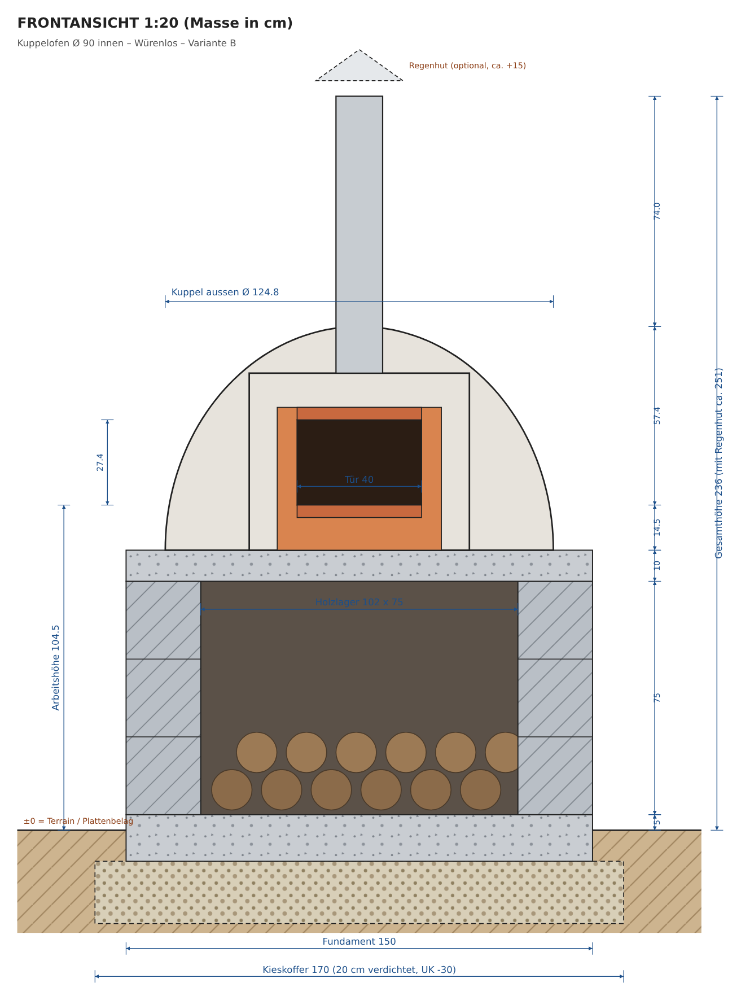
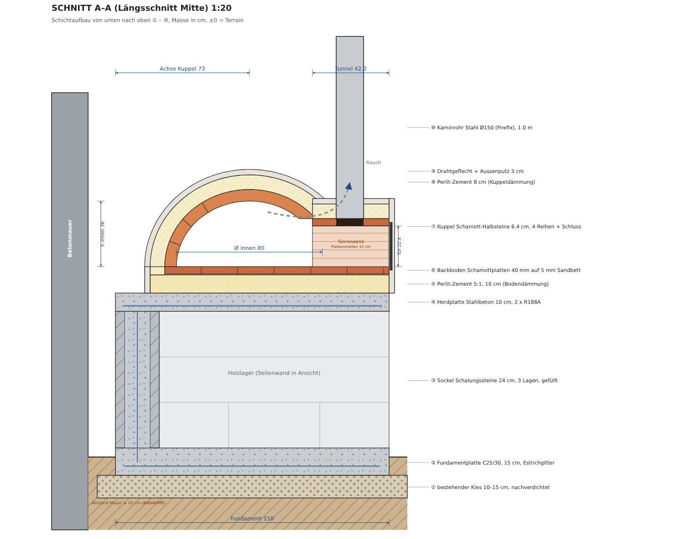
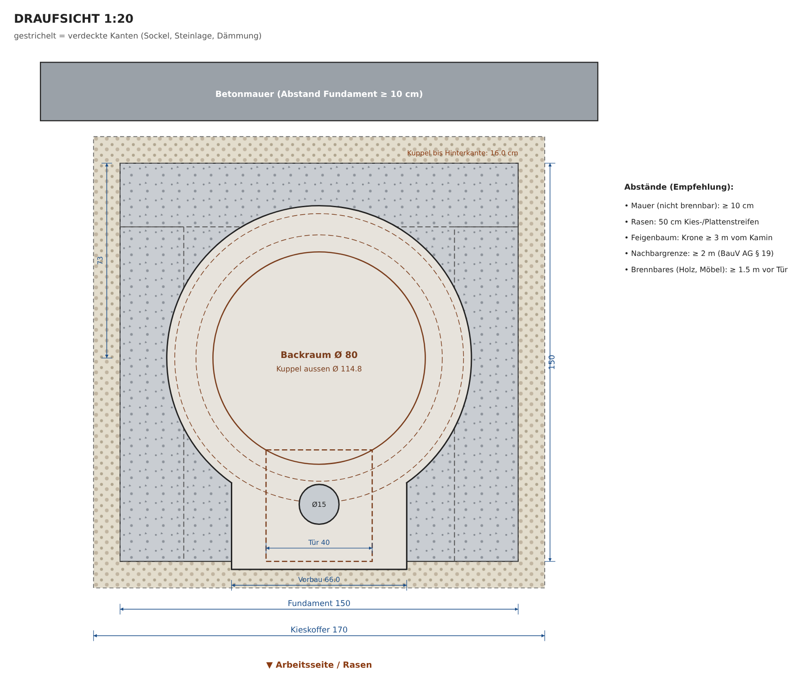
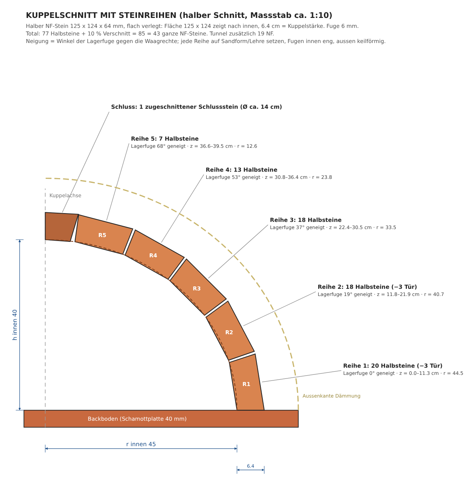

# Pizzaofen Würenlos – Bau- und Beschaffungsplan (Fassung 3)

**Stand:** Dienstag, 13.10.2026, 15:25 Uhr · Preise und **Lagerbestände live abgefragt** am 13.10.2026 (zuletzt 15:23 Uhr, alles verfügbar) · EUR-Kurs **1 EUR = 0.9312 CHF** (EZB, 12.10.2026)

> **Fassung 3 (15:25 Uhr): Einkauf in zwei Phasen, Abholkarte**
> - **Phase 1 · Sockel** (Fundament, Sockel, Herdplatte): Fahrt **A** heute OBI Oftringen, Fahrt **B** Mi OBI Volketswil, **K1–K4** Kieswerk. CHF 1'282.25.
> - **Phase 2 · Ofen:** **eine Fahrt C am Mo 19.10.** nach OBI Volketswil, CHF 679.55.
> - Knappe Ofen-Teile fahren in Phase 1 mit (alle 39 Schamottsteine, 1 Platte, Türblech, Sand: CHF 388.95), weil es sie sonst nirgends in genügender Zahl gibt.
> - **2 Tonnen pro Fahrt sind mit Kat. B nicht erlaubt** (Kapitel 5.4). Es bleibt bei max. 900 kg pro Fahrt.
> - Neu: **`karte.html`**, eine Abholkarte mit allen Stopps, Ladelisten, Navigation (Google Maps) und Nutzlast-Rechner.

> **Was Fassung 2 gegenüber Fassung 1 geändert hat (und warum)**
> 1. **Lagerbestand geprüft statt angenommen.** Ich habe die öffentliche Bestandsschnittstelle von obi.ch abgefragt, dieselbe Funktion wie „Verfügbarkeit im Markt prüfen". **Keine Filiale im Umkreis hat 62 Schamott-Normalsteine:** Volketswil 24, Oftringen 25, Basel 21, Schaffhausen 9, Winterthur 3. **Zement ist in Volketswil ausverkauft.** Mit Fassung 1 wärt ihr an der Kasse gescheitert.
> 2. **Nur noch Händler mit bestätigtem Bestand:** OBI Oftringen, OBI Volketswil, Kieswerk Tägerhard. Hornbach und Bauhaus fallen weg, weil ihre Bestände online nicht prüfbar sind.
> 3. **Kuppel Ø 80 cm statt 90 cm.** Mit allen echten Preisen und dem Werkzeug, das ihr kaufen müsst, kostet Ø 90 cm **CHF 2'115.60**, also **über 2000**. Ø 80 cm kostet **CHF 1'961.80**. Ø 100 cm ist heute nicht baubar: 56 Steine nötig, 49 im Umkreis.
> 4. **Keine Mietgeräte mehr.** Handstampfer und Rührwerk werden gekauft (zusammen CHF 150.90). Die Miete hätte zwei Rückgabefahrten à 64 km gebraucht, und ihre Verfügbarkeit war nicht prüfbar.
> 5. **Termine nach echter Wetterprognose** (Open-Meteo, Würenlos, abgerufen 13.10.) statt nach Klima-Mittelwerten.
> 6. **Alle früheren „ANNAHME"-Preise ersetzt.** Jedes Kleinteil hat jetzt OBI-Artikelnummer, Preis und Bestand.

> **Kurzfassung**
> - **Bau:** Kuppelofen **Ø 80 cm innen**. Die Kuppel besteht aus 62 halbierten Schamott-Normalsteinen (6.4 cm), darauf 8 cm Perlit-Dämmung. Der Backboden besteht aus Schamottplatten 40 mm. **Arbeitshöhe 104.5 cm, Gesamthöhe 231 cm.**
> - **Kosten:** **CHF 1'961.80 alles inklusive** (Material, Kleinmaterial, Schutz und das Werkzeug, das ihr kaufen müsst). **Reserve CHF 38.20.** Allein die Positionen eurer Budgetliste (Material + Kleinmaterial) kosten CHF 1'580.10.
> - **Heute (Phase 1):** Fahrt **A** nach OBI Oftringen (533 kg), Abfahrt spätestens 17:30.
> - **Mittwoch und Donnerstag (Phase 1):** Fahrt **B** nach Volketswil (836 kg) und 4 kurze Fahrten zum Kieswerk, je höchstens 900 kg. Das Fahrzeug bleibt jederzeit unter 3'060 kg und ist mit Kat. B legal.
> - **Mo 19.10. (Phase 2):** Fahrt **C** nach Volketswil (193 kg): Platten, Mörtel, Perlit, Kaminrohr, Tür, Brandschutz.
> - **Bewilligung:** Laut BauV AG § 49 bewilligungsfrei, **wenn 2 m Abstand zur Grenze** eingehalten sind oder der Nachbar schriftlich zustimmt (Formular in Kapitel 9).
> - **Wetter:** Bis 22.10. trocken, nachts über 6 °C. Fundament am **Do 15.10.**, Herdplatte am **So 18.10.**, Kuppel am **So 25.10.**

---

## 0. Offene Punkte: keine

Jeder offene Punkt aus Fassung 1 ist jetzt geklärt oder hat eine feste Entscheidungsregel.

| Früher offen | Jetzt |
|---|---|
| Lagerbestand Schamottsteine | **Geprüft:** Oftringen 25, Volketswil 24. Ihr kauft 25 + 14 = 39 (Bedarf 35 inkl. 10 % Verschnitt) |
| Preise Hornbach nicht direkt abrufbar | Hornbach gestrichen. Alle Preise stammen von obi.ch-Produktseiten, **jeder einzeln nachgeprüft** |
| Schalungssteine einzeln verkäuflich? | OBI „Kann Schalungsstein 24 cm" gibt es einzeln, 36 an Lager |
| Zement | In Volketswil 0 → Kauf in **Oftringen (191 an Lager)** |
| Kieswerk: Selbstverlad erlaubt? | Die Privatpreisliste von Tägerhard nennt Preise **pro Kübel (CHF 3.–) und Karrette (CHF 12.–), ab 5 Karretten CHF 60.–/m³** und sagt: „Bezug von Kieskomponenten während den Öffnungszeiten immer möglich." Ihr füllt selbst in eure Mörtelkästen |
| Mietgeräte (Verfügbarkeit, Rückgabefahrten) | Gestrichen. Betonstampfer CHF 43.95 + Rührwerk CHF 106.95, Bestand geprüft |
| Kleinmaterial CHF 85 geschätzt | Ersetzt durch 23 konkrete Artikel mit Nummer, Preis und Bestand |
| Bestand Kaminrohr | OBI Firefix Ø 150, 1 m: 2 Stück in Volketswil |
| Regenhut (8 Tage Lieferzeit, Höhe > 2.50 m) | Gestrichen. Abdeckblech aus dem Türblech-Rest, nur auf den kalten Ofen legen |
| Wetter nur als Mittelwert | Echte 16-Tage-Prognose → feste Termine (Kapitel 7) |
| Gewicht Schalungsstein | laut OBI-Datenblatt 27.0 kg |
| Füllbeton Schalungsstein | laut KANN-Datenblatt 121 l/m² |
| Versand/Lieferadresse Deutschland | schamotte-shop.de: Paket 0–150 kg €7.90–79.90; Lieferadresse Konstanz €3–15/Paket. Durchgerechnet: lohnt nicht |
| Preis Dämmpaket Bausatz | kuppelofen.de: CS-Platte €60, Keramikfaser €80, Mörtel €45 |
| Fahrt A heute nicht mehr möglich | Feste Regel in 4.3 |
| Werkzeug vorhanden? | 10 Haushaltswerkzeuge mit Preis und Bestand. Was fehlt, kauft ihr bei Fahrt B in Volketswil (Kapitel 8) |
| Nutzlast eures Talento | Formular und Regel in 5.2, gelten für jeden Wert im Fahrzeugausweis |
| Grenzabstand/Nachbar | Messregel und Zustimmungsformular in Kapitel 9 |

Ein Rest-Risiko bleibt: Jemand kauft zwischen meiner Abfrage und eurer Abholung. Deshalb ruft ihr vor Fahrt A an und lasst die Steine bereitlegen (Text in 4.5), und alle 39 Schamottsteine kauft ihr schon in Phase 1. Für den Notfall gilt **Plan B in 10.3**.

---

## 1. Variantenvergleich und Empfehlung

### 1.1 Grösse: 100, 90 oder 80 cm?

Grundlagen der Rechnung: flache, neapolitanische Kuppel (Höhe ≈ 0.9 × Radius), Kuppelwand 6.4 cm, Dämmung 8 cm, Putz 3 cm, Sockel 150 × 150 cm. Die Tür ist 40 cm breit, ihre Höhe beträgt ca. 63 % der Kuppelhöhe.

| Kriterium | **Ø 80 cm** | Ø 90 cm | Ø 100 cm (Skizze) |
|---|---|---|---|
| Backfläche | **0.5 m²** | 0.64 m² | 0.79 m² |
| Pizzen Ø 30 cm gleichzeitig | **2** | 2–3 | 3–4 |
| Kuppel aussen | **114.8 cm** | 124.8 cm | 134.8 cm (nur 7.6 cm Rand) |
| Eingangstiefe | **42.0 cm** | 41.7 cm | 31.2 cm (zu kurz für den Kamin) |
| Türhöhe (63 %-Regel) | **22.4 cm** | 27.0 cm | 27.0 cm |
| Schamott-NF nötig inkl. 4 Reserve | **39** | 47 | 56 (**nicht verfügbar**, 49 im Umkreis) |
| Schamottmasse Kuppel + Boden | **188 kg** | 223 kg | 268 kg |
| Wärme, um die Masse auf Ø 350 °C zu bringen | **15.51 kWh** | 18.37 kWh | 22.09 kWh |
| Aufheizzeit bis ~450 °C (Schätzung) | **ca. 40–50 min** | ca. 45–60 min | ca. 60–75 min |
| **Gesamtkosten alles inklusive** | **CHF 1'961.80** ✔ | CHF 2'115.60 ✘ | CHF 2'230.00 ✘ |

**Empfehlung: Ø 80 cm.**
1. **Budget:** Mit allen echten Preisen und dem nötigen Werkzeug bleibt nur Ø 80 cm unter CHF 2000.
2. **Verfügbarkeit:** Ihr braucht 39 von 49 Steinen, es bleibt Puffer. Bei 90 cm wären es 47 von 49, also kaum Puffer für Bruch.
3. **Aufheizen:** 16 % weniger Masse als bei 90 cm, nach 40–50 min ist der Ofen pizzabereit, und er braucht weniger Holz.
4. **Platz:** Die Kuppel misst aussen 114.8 cm, der Sockel 150 cm. Rundum bleibt Rand für Putz und Wasserablauf, vorne ein 42 cm tiefer Eingang mit Kamin.
5. **Nutzung:** 2 Pizzen gleichzeitig bei 60–90 s Backzeit, also gut 30 Pizzen pro Stunde.

**Kuppelstärke 6.4 cm (halbierte NF-Steine, flach): passt.** Die Kuppel wird leicht, günstig und heizt schnell, ideal für Pizza. Für langes Brotbacken wären 10–12 cm besser, dafür gibt es heute aber nicht genug Steine.

**Weitere begründete Anpassungen:** Die Gesamthöhe beträgt **231 cm** (Kaminrohr 1 m, ohne Regenhut). Der Sockel besteht aus 3 Lagen Schalungssteinen plus Herdplatte, deren Oberkante auf 90 cm liegt. Die **Arbeitshöhe beträgt 104.5 cm**. Der Boden besteht aus Schamottplatten 40 mm, das gibt weniger Fugen. Die **Eingangswände** sind aus längs halbierten Schamottplatten, weil die Normalsteine knapp sind.

### 1.2 Die drei Varianten

| | A) Komplettbausatz | **B) Selbstbau Ø 80 cm (Empfehlung)** | C) Günstigste realistische Lösung |
|---|---|---|---|
| Inhalt | Les Cheminées FD 100 (kleinster der Serie) + Dämmpaket (3 CS-Platten, 4 Keramikfaser, Mörtel) + Sockel aus B | Einzelteile, heute in CH mit geprüftem Bestand | wie B, aber Rührwerk, Stampfer und Kellen ausgeliehen; Löschdecke und Ascheeimer erst vor dem 1. Feuer |
| **Preis** | **ca. CHF 2'519.06** (Bausatz €1'694 → CHF 1'432.96 mit MWST-Rückerstattung + 8.1 % CH) | **CHF 1'961.80** | **CHF 1'744.45** |
| Heute abholbar | **Nein**: Lager in Ruderatshofen (Allgäu), ~230 km, Lieferung nur DE/AT | **Ja** | Ja |
| Aufwand | 60–80 Personenstunden | 110–130 Personenstunden | wie B + Ausleihen |
| Schwierigkeit | mittel (Teile bis 100 kg, kein Kran) | mittel–hoch (Steine schneiden, Kuppel mauern) | wie B |
| Optik | gleichmässig, „wie gekauft" | klassischer verputzter Iglu | wie B |
| Risiken | Budget weit überschritten; Abholung ausserhalb 100 km; Sockel für 100-cm-Kuppel zu klein | Bestand (knappe Steine schon in Phase 1 gekauft), Wetter (Termine nach Prognose) | nur sinnvoll, wenn das Ausleihen sicher klappt |

Zum Vergleich: Ein CUPPO-90-Bausatz kostet €2'370 mit Spedition (ca. CHF 2'017.59), ohne Dämmung und Sockel. Schweizer Bausätze (pizzaofenbau.ch) kosten CHF 3'490–5'490. TheFiredome verkauft 2026 keine Bausätze.

**Unter CHF 1'500?** Mit geprüften Quellen und Abholung heute **nicht realistisch**. Das Minimum ist Variante C mit CHF 1'744.45. Billiger wäre nur eine Lehmkuppel, die wochenlang trocknen muss. Im Oktober und November geht das nicht.

> **Nehmt Variante B (Ø 80 cm).** Sie ist heute komplett abholbar, jeder Artikel ist an Lager, sie kostet alles inklusive CHF 1'961.80 und passt sauber auf euren Sockel.

---

## 2. Exakte Stückliste (Variante B, Ø 80 cm)

**Kategorien:** M Material · K Kleinmaterial · G Gebinde/Transport · S Schutz · W Werkzeug (bleibt euch) · B Brandschutz für den Betrieb. **„Bestand"** ist der Bestand im Markt laut obi.ch-Schnittstelle am 13.10.2026, ca. 12:15 Uhr.

| Nr. | Kat. | Produkt (Art.-Nr.) | Spezifikation / Rechnung | Menge | CHF/Einheit | CHF total | Gewicht | Händler: Menge von Bestand | Quelle |
|---|---|---|---|---|---|---|---|---|---|
| K1 | M | Kiesgemisch UG22 0/31.5 (Art. 60201) (60201) | Kieskoffer 1.70 x 1.70 x 0.20 m verdichtet = 0.578 m³; lose x 1.25 | 0.75 m³ | 60.00 | **45.00** | 1600 kg × 0.75 = 1200 kg | Kieswerk: Bezug immer möglich | [Link](https://taegerhardkies.ch/wp-content/uploads/2025/12/Grundpreisliste-2026.pdf) |
| K2 | M | Betonkies gewaschen 0/16 (Art. 20001) (20001) | 0.974 m³ Beton x 1900 kg/m³ | 1.1 m³ | 60.00 | **66.00** | 1800 kg × 1.1 = 1980 kg | Kieswerk: Bezug immer möglich | [Link](https://taegerhardkies.ch/wp-content/uploads/2025/12/Grundpreisliste-2026.pdf) |
| K3 | M | Sand gewaschen 0/4 (Art. 40001) (40001) | Sandform Kuppel 0.17 m³, danach Putz + Bodenbett | 0.25 m³ | 60.00 | **15.00** | 1500 kg × 0.25 = 375 kg | Kieswerk: Bezug immer möglich | [Link](https://taegerhardkies.ch/wp-content/uploads/2025/12/Grundpreisliste-2026.pdf) |
| O01 | M | Zement CEM I 42.5 N, 25 kg (4793972) | Beton 292 + Perlit 70 + Putz 27 = 389 kg | 16 Sack | 5.50 | **88.00** | 25 kg × 16 = 400 kg | Oftringen: 16 von 191 | [Link](https://www.obi.ch/zemente-kalke/zement-cem-i-42-5-n/p/4793972) |
| O02 | M | Kann Schalungsstein grau 24 cm (50 x 25 x 24) (5047857) | U-Sockel 3 Lagen à 8.04 Stk = 24.1 + 2 Reserve | 26 Stk | 5.95 | **154.70** | 27.0 kg × 26 = 702 kg | Volketswil: 26 von 36 | [Link](https://www.obi.ch/einfassungen-stufen-mauersysteme/kann-schalungsstein-grau-24-cm/p/5047857) |
| O03 | M | Catnic Baustahlmatte R188A 230 x 100 cm (Stäbe 6 mm) (5031802) | Herdplatte (trägt frei über 102 cm): 2 Matten à 140 x 100, 60 cm überlappt = 140 x 140, Hauptstäbe quer zur Öffnung; Reste = Steckeisen | 2 Stk | 22.95 | **45.90** | 5.6 kg × 2 = 11 kg | Volketswil: 2 von 26 | [Link](https://www.obi.ch/baustahl-baugitter/baustahlmatte-r188a-230-x-100-cm/p/5031802) |
| O03b | M | Catnic Estrichgitter verzinkt 200 x 100 cm (5031687) | Fundament (vollflächig auf Kies, nur Schwindriss-Bewehrung): 2 Stück nebeneinander, auf 140 x 140 schneiden | 2 Stk | 6.50 | **13.00** | 3.0 kg × 2 = 6 kg | Volketswil: 2 von 85 | [Link](https://www.obi.ch/baustahl-baugitter/estrichgitter-verzinkt-200-x-100-cm/p/5031687) |
| O04 | M | OSB-Platte N+F 1.8 x 62.5 x 250 cm (6464333) | Schalung Herdplatte, Feld 102 x 126 cm | 2 Stk | 17.00 | **34.00** | 16.9 kg × 2 = 34 kg | Volketswil: 2 von 107 | [Link](https://www.obi.ch/osb-platten-verlegeplatten/osb-platte-nut-und-feder-hxbxt-1-8-x-62-5-x-250-cm/p/6464333) |
| O05 | M | Schalbrett sägerau 23 x 150 mm, 3 m (2473270) | Fundamentrand 2 x 155 + 2 x 150 cm, Rest Herdplattenrand; im Markt halbieren lassen | 3 Stk | 11.95 | **35.85** | 4.7 kg × 3 = 14 kg | Volketswil: 3 von 63 | [Link](https://www.obi.ch/saegeraue-ware/schalbrett-saegerau-fichte-tanne-23-x-150-mm-laenge-3-m/p/2473270) |
| O06 | M | Brett sägerau 23 x 100 mm, 2 m (4895694) | 8 Stützen à 75 cm (je 2 Bretter verschraubt) unter Herdplattenschalung | 4 Stk | 4.95 | **19.80** | 2.1 kg × 4 = 8 kg | Volketswil: 4 von 23 | [Link](https://www.obi.ch/saegeraue-ware/brett-saegerau-fichte-tanne-23-x-100-mm-laenge-2-m/p/4895694) |
| O07 | M | Schamottestein 64 x 124 x 250 mm (NF) (5390067) | Kuppel: 69 Halbsteine = 35 NF (inkl. 10 % Verschnitt) + 4 Reserve | 39 Stk | 8.50 | **331.50** | 3.78 kg × 39 = 147 kg | Oftringen: 25 von 25; Volketswil: 14 von 24 | [Link](https://www.obi.ch/grillutensilien/schamottestein-hxbxt-64-x-124-x-250-mm/p/5390067) |
| O08 | M | Schamottestein 40 x 200 x 500 mm (5390026) | Boden 11 + Tunneldecke 2 + Tunnelwände 5 (längs halbiert = 10 Streifen) | 18 Stk | 18.95 | **341.10** | 7.4 kg × 18 = 133 kg | Oftringen: 1 von 12; Volketswil: 17 von 17 | [Link](https://www.obi.ch/grillutensilien/schamottestein-hxbxt-40-x-200-x-500-mm/p/5390026) |
| O09 | M | Sakret Schamottemörtel 5 kg (feuerbeständig bis 1100 °C) (2925493) | Bedarf 21.1 kg | 5 Sack | 17.95 | **89.75** | 5.0 kg × 5 = 25 kg | Volketswil: 5 von 15 | [Link](https://www.obi.ch/trockenmoertel/sakret-schamottemoertel-grau-5-kg/p/2925493) |
| O10 | M | Pflanzen-Perlit 100 l (3798733) | Perlit-Zement 5:1, Boden 10 cm + Kuppel 8 cm; Bedarf 270 l | 3 Sack | 29.95 | **89.85** | 9.4 kg × 3 = 28 kg | Volketswil: 3 von 8 | [Link](https://www.obi.ch/perlite-vermiculite/pflanzen-perlit-100-l/p/3798733) |
| O11 | M | Firefix Rauchrohr schwarz Ø 150 mm, 1 m (Stahl, Senotherm-Lack) (2480333) | Kaminrohr, im Ø15.5-Loch der Tunneldeckplatten eingemörtelt | 1 Stk | 59.95 | **59.95** | 7.8 kg × 1 = 8 kg | Volketswil: 1 von 2 | [Link](https://www.obi.ch/zubehoer-fuer-cheminees-und-schwedenoefen/firefix-rauchrohr-schwarz-15-cm/p/2480333) |
| O12 | M | Gah Alberts Sechseck-Geflecht verzinkt 25 mm, 1 m x 10 m (4915658) | Putzträger Aussenschale 2.65 m² | 1 Rolle | 27.95 | **27.95** | 3.5 kg × 1 = 4 kg | Volketswil: 1 von 4 | [Link](https://www.obi.ch/draht-zaungeflecht/gah-alberts-sechseck-geflecht-verzinkt-hoehe-1-m-laenge-10-m/p/4915658) |
| O13 | M | Glattblech Stahl 500 x 1000 x 0.75 mm (4983821) | Ofentür 46 x 28 cm (Öffnung 40 x 22.4); Rest = Kaminabdeckung Ø 20 cm | 1 Stk | 23.50 | **23.50** | 2.9 kg × 1 = 3 kg | Oftringen: 1 von 3 | [Link](https://www.obi.ch/bleche/glattblech-stahl-500-x-1-000-mm-staerke-0-75-mm/p/4983821) |
| O14 | K | Siro Möbelgriff S113 Kiefer roh, Lochabstand 96 mm (5786116) | Türgriff (mit 2 Schrauben + Holzklötzchen als Abstand) | 1 Stk | 6.95 | **6.95** | 0.1 kg × 1 = 0 kg | Volketswil: 1 von 6 | [Link](https://www.obi.ch/moebelgriffe-moebelknoepfe/siro-moebelgriff-s113-kiefer-roh-lochabstand-96-mm/p/5786116) |
| O15 | K | Albrecht Thermolack schwarz matt 125 ml (5756416) | Tür + Kaminrohr-Ausbesserung | 1 Stk | 12.50 | **12.50** | 0.2 kg × 1 = 0 kg | Volketswil: 1 von 9 | [Link](https://www.obi.ch/metallschutzlacke/albrecht-thermolack-schwarz-matt-125-ml/p/5756416) |
| O16 | K | LUX Universalschraube Senkkopf 4 x 40 mm, 200 Stk (4048450) | Schalung, Stützen, Griff | 1 Pack | 9.95 | **9.95** | 0.6 kg × 1 = 1 kg | Volketswil: 1 von 2 | [Link](https://www.obi.ch/spanplattenschrauben-universalschrauben/lux-universalschraube-senkkopf-4-x-40-mm-tx-antrieb-200-stk-/p/4048450) |
| O17 | K | OBI Bindedraht verzinkt 1.4 mm x 20 m (4582912) | Matten, Geflecht verankern | 1 Rolle | 5.95 | **5.95** | 0.3 kg × 1 = 0 kg | Volketswil: 1 von 7 | [Link](https://www.obi.ch/weitere-gartenhelfer/obi-bindedraht-verzinkt-1-4-mm-x-20-m/p/4582912) |
| O18 | K | LUX Gewebeplane grün 4 x 5 m (2435469) | 1 x Ofen (Regen/Frost), 1 x Zement/Material | 2 Stk | 12.95 | **25.90** | 1.5 kg × 2 = 3 kg | Oftringen: 2 von 9 | [Link](https://www.obi.ch/baufolien-planen/lux-gewebeplane-gruen-4-x-5-m/p/2435469) |
| O19 | K | LUX Diamant-Trennscheibe Universal 125 mm (1755560) | Schamott schneiden (54 Schnitte) | 1 Stk | 21.50 | **21.50** | 0.2 kg × 1 = 0 kg | Volketswil: 1 von 2 | [Link](https://www.obi.ch/zubehoer-fuer-winkelschleifer/lux-diamant-trennscheibe-universal-125-mm/p/1755560) |
| O20 | K | LUX Trennscheiben-Sparpack Metall 125 mm (1206051) | Matten + Türblech schneiden | 1 Pack | 8.35 | **8.35** | 0.4 kg × 1 = 0 kg | Volketswil: 1 von 9 | [Link](https://www.obi.ch/zubehoer-fuer-winkelschleifer/lux-trennscheiben-sparpack-metall-125-mm/p/1206051) |
| O21 | K | LUX Maurerschnur rot 20 m (1240837) | Abstecken, Fluchten | 1 Stk | 3.65 | **3.65** | 0.1 kg × 1 = 0 kg | Volketswil: 1 von 5 | [Link](https://www.obi.ch/pruefwerkzeuge-messwerkzeuge/lux-maurerschnur-classic-rot-20-m/p/1240837) |
| O22 | K | LUX Zimmermannsbleistift 24 cm (1237163) | Anzeichnen | 2 Stk | 2.25 | **4.50** | 0.02 kg × 2 = 0 kg | Volketswil: 2 von 63 | [Link](https://www.obi.ch/pruefwerkzeuge-messwerkzeuge/lux-zimmermannsbleistift-classic-24-cm/p/1237163) |
| O23 | G | Jopa Mörtelkasten schwarz 90 l (5799150) | Mischen + Kiestransport (im Wagen befüllen) | 4 Stk | 7.95 | **31.80** | 2.0 kg × 4 = 8 kg | Oftringen: 4 von 25 | [Link](https://www.obi.ch/baueimer-moertelkuebel/jopa-moertelkasten-schwarz-fassungsvermoegen-90-l/p/5799150) |
| O24 | G | Jopa Mörteleimer mit Bügel 20 l (5799200) | Kiestransport (max. 15 l füllen = 25 kg), Wasser | 10 Stk | 3.50 | **35.00** | 0.68 kg × 10 = 7 kg | Oftringen: 10 von 31 | [Link](https://www.obi.ch/baueimer-moertelkuebel/jopa-moerteleimer-mit-buegel-fassungsvermoegen-20-l/p/5799200) |
| O25 | G | Spanngurt Unitec mit Klemmverschluss 3 m, 400 kg (4904546) | Ladungssicherung, 4 Stück | 4 Stk | 8.95 | **35.80** | 0.3 kg × 4 = 1 kg | Oftringen: 4 von 5 | [Link](https://www.obi.ch/spanngurte-zurrgurte/spanngurt-unitec-mit-klemmverschluss-3-m-400-kg/p/4904546) |
| O26 | G | Antirutschunterlage schwarz 30 x 150 cm (5102272) | unter die Ladung | 3 Stk | 5.50 | **16.50** | 0.4 kg × 3 = 1 kg | Oftringen: 3 von 18 | [Link](https://www.obi.ch/teppichgleitschutz/antirutschunterlage-schwarz-30-x-150-cm/p/5102272) |
| O27 | S | LUX Feinstaubmaske FFP3 mit Ventil, 2 Stk (3084563) | Steine schneiden (Quarzstaub), Perlit, Zement | 1 Pack | 19.50 | **19.50** | 0.1 kg × 1 = 0 kg | Volketswil: 1 von 12 | [Link](https://www.obi.ch/atemschutz-zubehoer/lux-feinstaubmaske-ffp3-2-stueck/p/3084563) |
| O28 | S | Schutzbrille mit Bügeln (3084571) | 2 Personen | 2 Stk | 6.50 | **13.00** | 0.05 kg × 2 = 0 kg | Volketswil: 2 von 11 | [Link](https://www.obi.ch/augenschutz/schutzbrille-mit-buegeln/p/3084571) |
| O29 | S | 3M Gehörschutzstöpsel mit Kordel 1271 (5087713) | Winkelschleifer | 1 Pack | 8.95 | **8.95** | 0.05 kg × 1 = 0 kg | Volketswil: 1 von 4 | [Link](https://www.obi.ch/gehoerschutz/3m-gehoerschutzstoepsel-mit-kordel-1271/p/5087713) |
| O30 | S | PU-Handschuh Gr. 8 (6608442) | Zement ist ätzend: immer Handschuhe | 4 Paar | 0.95 | **3.80** | 0.05 kg × 4 = 0 kg | Oftringen: 4 von 107 | [Link](https://www.obi.ch/arbeitshandschuhe/pu-handschuh-gr-8/p/6608442) |
| O31 | W | Betonstampfer 13 x 20 cm, Stiel 105 cm (7.5 kg) (5474523) | Kieskoffer verdichten (ersetzt Mietrüttelplatte) | 1 Stk | 43.95 | **43.95** | 7.5 kg × 1 = 8 kg | Oftringen: 1 von 1 | [Link](https://www.obi.ch/baugeraete/betonstampfer-13-x-20-cm-stiellaenge-105-cm/p/5474523) |
| O32 | W | Einhell Farb-Mörtelrührer TE-MX 1600-2 CE (1600 W) (5047022) | Beton in 40-l-Chargen, Perlit, Mörtel, Putz (ersetzt Mietmischer) | 1 Stk | 106.95 | **106.95** | 5.2 kg × 1 = 5 kg | Volketswil: 1 von 4 | [Link](https://www.obi.ch/multitools-spezialwerkzeuge/einhell-farb-moertelruehrer-te-mx-1600-2-ce/p/5047022) |
| O33 | W | LUX Kellenset 3-tlg. (5907696) | Maurer-/Putzkelle | 1 Set | 17.50 | **17.50** | 1.04 kg × 1 = 1 kg | Volketswil: 1 von 5 | [Link](https://www.obi.ch/maurer-fliesenleger-verlegewerkzeuge/lux-kellenset-3-tlg-/p/5907696) |
| O34 | W | LUX Fugenkelle Classic 10 mm (1240233) | Fugen Kuppel | 1 Stk | 7.50 | **7.50** | 0.1 kg × 1 = 0 kg | Volketswil: 1 von 6 | [Link](https://www.obi.ch/maurer-fliesenleger-verlegewerkzeuge/lux-fugenkelle-classic-10-mm/p/1240233) |
| O35 | B | Abus Löschdecke LD1118 (5295126) | Brandschutz Betrieb (+ Gartenschlauch) | 1 Stk | 16.50 | **16.50** | 0.5 kg × 1 = 0 kg | Volketswil: 1 von 18 | [Link](https://www.obi.ch/brandschutz/abus-loeschdecke-ld1118/p/5295126) |
| O36 | B | Valo Ascheeimer oval mit Deckel schwarz 24 l (6003131) | Glut/Asche 24 h auskühlen | 1 Stk | 24.95 | **24.95** | 1.6 kg × 1 = 2 kg | Volketswil: 1 von 20 | [Link](https://www.obi.ch/zubehoer-fuer-cheminees-und-schwedenoefen/valo-ascheeimer-oval-mit-deckel-schwarz-hxbxt-42-x-31-x-61-cm-24-l/p/6003131) |

**Summen:** Material CHF 1'480.85 · Kleinmaterial CHF 99.25 · Gebinde CHF 119.10 · Schutz CHF 45.25 · Werkzeug CHF 175.90 · Brandschutz CHF 41.45 → **Total CHF 1'961.80** · Gewicht 5'117 kg

### 2.1 Schamottsteine: Sorte und Stückzahl der Kuppel

**Sorte:** Schamottestein **NF 250 × 124 × 64 mm** (OBI Art. 5390067, 3.78 kg). Für einen Pizzaofen reicht Schamotte mit Al₂O₃ ≥ 30 % (A30/B30, ≈ SK 30–32) und einer Anwendungstemperatur ≥ 1100 °C. Die Kuppel-Innenseite erreicht 450–500 °C, die Flammenspitzen ca. 800 °C. **Regel an der Kasse:** Nennt das Etikett weniger als 1000 °C, nehmt ihr die Steine trotzdem. Sie reichen für Pizzatemperaturen, und im Umkreis gibt es keine Alternative.

**Verlegeart:** Jeder Stein wird **halbiert** (125 × 124 × 64 mm). Die Fläche 125 × 124 zeigt nach innen, die Kuppelstärke beträgt 6.4 cm, die Fugen 6 mm.

**Rechnung (Ø 80 innen, Höhe 36 cm, halbe Rotationsellipse):**
1. Mittelfläche: a = 40 + 3.2 = **43.2 cm**, c = 36 + 3.2 = **39.2 cm**
2. Viertelbogen, numerisch integriert: **L = 64.8 cm**
3. Reihenteilung: 12.4 + 0.6 = 13.0 cm → **4 volle Reihen**, Rest 12.8 cm → **Schluss aus 3 zugeschnittenen Halbsteinen**
4. Halbsteine pro Reihe = ⌈Umfang in Reihenmitte ÷ (12.5 + 0.6)⌉, abzüglich Tür (40 cm → 3 Halbsteine in den Reihen 1 und 2):

| Reihe | Höhe innen | Radius innen | Neigung Lagerfuge | Halbsteine |
|---|---|---|---|---|
| 1 | 0.0–11.2 cm | 39.5 cm | 0.0° | **18** (−3 Tür) |
| 2 | 11.7–21.5 cm | 35.4 cm | 20.7° | **16** (−3 Tür) |
| 3 | 21.9–29.4 cm | 27.7 cm | 40.2° | **15** |
| 4 | 29.7–34.3 cm | 17.6 cm | 58.0° | **10** |
| Schluss | 34.3–36 cm | – | – | **3** (zugeschnitten) |

5. **Summe: 62 Halbsteine.** Gegenprobe über die Fläche: 1.101 m² minus Tür 0.09 m² ergibt 59.4 Halbsteine. Das passt.
6. +10 % Verschnitt ergibt **69 Halbsteine = 35 NF**. Ihr kauft **39**, also 4 Reserve für Bruch und Türbogen.

### 2.2 Backboden und Eingang

- **Boden:** Kreis Ø 92.8 cm (die Kuppel steht darauf) plus Eingangsboden 60 cm breit = **0.879 m²**. ÷ 0.10 m² × 1.15 ergibt **11 Platten** 40 × 200 × 500.
- **Eingangswände:** je **5 Lagen** Plattenstreifen 500 × 100 × 40 (Platte längs halbiert). Eine Lage ist 4.6 cm hoch, das ergibt eine **Öffnung von 22.4 × 40 cm** bei 10 cm Wandstärke. 10 Streifen = **5 Platten**.
- **Eingangsdecke:** 2 Platten 500 × 200 quer über die 40 cm Öffnung, mit je 5 cm Auflager. Dazwischen das **Kaminloch Ø 15.5 cm**, aus beiden Platten je zur Hälfte geschnitten.
- **Total 18 Platten** (Volketswil 17 + Oftringen 1).

### 2.3 Mörtel, Dämmung, Beton, Kies, Armierung

- **Schamottmörtel:** Halbsteine 62 × 95.6 cm³ + Streifen 10 × 324 cm³ + Plattenauflager 0.8 l = **10.2 l**. × 1.6 kg/l × 1.3 = **21.1 kg → 5 Sack Sakret à 5 kg** (bis 1100 °C).
- **Perlit-Zement 5 : 1:** Boden 10 cm 0.104 m³ + Kuppel 8 cm 0.121 m³ + Eingangsdecke 0.02 m³ = 0.245 m³. × 1.1 = **270 l → 3 Säcke à 100 l**, dazu Zement 70.1 kg.
- **Beton C25/30, selbst gemischt:** Fundament 0.338 m³ + Füllung Schalungssteine (3.015 m² × 121 l/m²) 0.365 m³ + Herdplatte 0.225 m³, × 1.05 = **0.974 m³**.
  - Rezept für 83 l Beton: **1 Sack Zement (25 kg) + 9 Eimer à 10 l Betonkies 0/16 (≈ 158 kg) + ca. 14 l Wasser**. Mit dem Rührwerk mischt ihr jeweils die Hälfte davon (½ Sack, 4½ Eimer, 7 l Wasser) im 90-l-Mörtelkasten.
  - Zement 292.1 kg + Betonkies 1'850 kg (1.028 m³ lose). Gekauft werden **1.10 m³**.
- **Zement total:** 292.1 + 70.1 + Putz 26.8 = **389.0 kg → 16 Sack**.
- **Kieskoffer:** 1.70 × 1.70 × 0.20 = 0.578 m³ verdichtet, × 1.25 = 0.72 m³ lose → **0.75 m³** (1'200 kg).
- **Sand 0/4:** 0.12 m³ für die Sandform, danach für den Putz wiederverwendet (0.10 m³) + Bodenbett → **0.25 m³**.
- **Armierung:**
  - **Herdplatte** (spannt frei über 102 cm): 2 × R188A 230 × 100, je auf 140 × 100 schneiden, 60 cm überlappen, Hauptstäbe quer zur Öffnung.
  - **Fundament** (liegt vollflächig auf verdichtetem Kies, Last ca. 11 kN/m²): 2 × Estrichgitter 200 × 100 gegen Schwindrisse.
  - **Steckeisen:** 12 L-Eisen aus den R188A-Resten (90 × 100).
- **Abstandhalter für die Bewehrung:** 12 Stück 5 × 5 cm aus einer der ausgebauten Gartenplatten schneiden (Winkelschleifer mit Diamantscheibe), kostenlos.

---

## 3. Bauzeichnungen

Die Zeichnungen werden direkt aus den Rechenwerten erzeugt (`zeichnungen/zeichnungen.py`), als SVG und PNG.

| Nr. | Schicht | von (cm) | bis (cm) | Dicke |
|---|---|---|---|---|
| ① | Kieskoffer 0/31.5 verdichtet, 170 × 170 | −30 | −10 | 20 cm |
| ② | Fundamentplatte C25/30 + Estrichgitter, 150 × 150 | −10 | +5 | 15 cm |
| ③ | Sockel KANN-Schalungssteine 24 cm, 3 Lagen, gefüllt, mit Steckeisen | +5 | +80 | 75 cm |
| ④ | Herdplatte Stahlbeton, 2 × R188A | +80 | +90 | 10 cm |
| ⑤ | Bodendämmung Perlit-Zement 5 : 1 | +90 | +100 | 10 cm |
| ⑥ | Sandbett 5 mm + Schamottplatten 40 mm | +100 | **+104.5** | 4.5 cm |
| ⑦ | Kuppel aus halben NF-Steinen, innen Ø 80 × 36 | +104.5 | +147.3 | 6.4 cm |
| ⑧ | Perlit-Zement | | +155.3 | 8 cm |
| ⑨ | Sechseckgeflecht + Zementputz 1 : 4 | | **+157.9** | 3 cm |
| ⑩ | Eingang 40 × 22.4, Deckplatten (Oberkante +130.9), Kaminrohr Ø 150 × 1 m | +130.9 | **+230.9** | |

### Frontansicht

### Schnitt A–A

### Draufsicht

### Kuppelschnitt mit Steinreihen und Neigungen

**Neigung** heisst: Winkel der Lagerfuge gegen die Waagrechte. Reihe 1 liegt bei 0°, Reihe 4 bei 58°. Gemauert wird die ganze Kuppel über eine **Sandform**: feuchter Sand (0.12 m³) in der Innenform, mit einer Schablone aus einem OSB-Rest (Halbellipse 80 × 36 cm) abgezogen und mit nassem Zeitungspapier abgedeckt.

---

## 4. Einkaufsroute

### 4.1 Händler (alle Angaben geprüft)

| Händler | Adresse | Distanz / Fahrzeit* | Öffnungszeiten (obi.ch, 13.10.) | Telefon |
|---|---|---|---|---|
| **OBI Oftringen** | Ackerweg 2, 4665 Oftringen | 42.3 km / 31–39 min | **Mo–Do 08–19, Fr 08–20, Sa 08–18** | 058 329 15 00 |
| **OBI Volketswil** | Industriestrasse 20, 8604 Volketswil | 31.8 km / 27–34 min | **Mo–Fr 08–20, Sa 08–18** | 058 329 12 00 |
| **Tägerhard Kies AG** | Tägerhardstrasse 151, 5430 Wettingen | 3.3 km / 6–8 min | **Mo–Fr 07:00–12:00, 13:00–16:45** | 056 426 70 45 |
| OBI Winterthur (nur Plan B) | Industriestrasse 44, 8404 Winterthur | 41 km / 37–46 min | Mo–Fr 08–20, Sa 08–18 | 058 329 19 00 |
| Bauverwaltung Würenlos | Schulstrasse 26, 5436 Würenlos | – | 08:00–11:30, 14:00–16:00 | 056 436 87 50 |

\*OSRM-Routing (freie Strasse), dazu +25 % für Kastenwagen und Verkehr. **Alle Stopps mit Ladeliste und Navigationsknopf: `karte.html`.**

### 4.2 Zwei Phasen

Zuerst kauft ihr alles für den **Unterbau** (Fundament, Sockel aus Schalungssteinen, Herdplatte) und baut ihn bis So 18.10. Den **Ofen** kauft ihr am Mo 19.10. Ausnahme: Was knapp ist, nehmt ihr schon in Phase 1 mit. Schamottsteine gibt es nur in Oftringen (25) und Volketswil (24). Fehlen sie später, steht der Bau.

| Fahrt | Wann | Wohin | Phase | Ladung | CHF |
|---|---|---|---|---|---|
| **A** | Di 13.10. heute, Abfahrt spätestens 17:30 (Markt offen bis 19:00) | OBI Oftringen | 1 · Sockel | 533 kg | 535.70 (davon Ofen vorgezogen 254.95) |
| **K1** | Mi 14.10. 07:00 | Kieswerk Tägerhard | 1 · Sockel | 896 kg | 33.60 |
| **B** | Mi 14.10. 08:15 | OBI Volketswil | 1 · Sockel | 836 kg | 620.55 (davon Ofen vorgezogen 119.00) |
| **K2** | Mi 14.10. 13:00 | Kieswerk Tägerhard | 1 · Sockel | 898 kg | 31.20 |
| **K3** | Do 15.10. 07:00 | Kieswerk Tägerhard | 1 · Sockel | 900 kg | 30.00 |
| **K4** | Do 15.10. 08:00 | Kieswerk Tägerhard | 1 · Sockel | 861 kg | 31.20 (davon Ofen vorgezogen 15.00) |
| **C** | Mo 19.10. 08:00 (spätestens Di 20.10. – Perlit wird am Mi 21.10. gebraucht) | OBI Volketswil | 2 · Ofen | 193 kg | 679.55 |

**Phase 1 · Sockel: CHF 1'282.25**, davon Ofen-Material vorgezogen CHF 388.95. **Phase 2 · Ofen: CHF 679.55.** Total CHF 1'961.80.

### 4.3 Heute, Dienstag 13.10., und Regeln

| Zeit | Was |
|---|---|
| **sofort** | OBI Oftringen anrufen (Text 4.5): 25 Schamottsteine und 16 Sack Zement bereitlegen lassen |
| bis 17:30 | **Fahrt A** losfahren: Würenlos → OBI Oftringen → Würenlos (85 km), Ladung 533 kg |
| ca. 19:30 | Abladen. Zement auf Bretter, unter die Plane. Steine trocken lagern |
| abends | Schnurgerüst 1.70 × 1.70 m (10 cm zur Mauer), Gartenplatten auf 1.9 × 1.9 m abheben. **Werkzeug-Check** (Kapitel 8). Abstand zur Grenze messen (Kapitel 9) |

| Situation | Dann |
|---|---|
| Fahrt A **heute nicht bis 17:30** möglich | Mittwoch: 08:00 **A**, 10:15 **K1**, 11:00 **B**, 14:00 **K2**. Donnerstag bleibt, das Fundament auch. |
| Oftringen hat **weniger als 25 Schamottsteine** | Nehmt, was da ist. Den Rest bei Fahrt B zusätzlich in Volketswil (24 am Lager), sonst OBI Basel (21). |
| Bei Fahrt C fehlen **Platten** in Volketswil | Rest in **OBI Winterthur** (13 Stück am 13.10.), 25 km weiter, auf der Karte gestrichelt |
| Der Markt verlangt einen anderen Preis | Es gilt der Marktpreis (OBI weist darauf hin). Dafür ist die Reserve von CHF 38.20 da. |

### 4.4 Mittwoch und Donnerstag

| Zeit | Fahrt | Ziel | Ladung |
|---|---|---|---|
| Mi 07:00 | **K1** | Kieswerk: 0.56 m³ Kiesgemisch 0/31.5 | 896 kg |
| Mi 08:15 | **B** | OBI Volketswil: 26 Schalungssteine, 2 Baustahlmatten, 2 Estrichgitter, 2 OSB, 3 Schalbretter, 4 Bretter, Rührwerk, Kellen, Schutz, 14 Schamottsteine | 836 kg |
| Mi 13:00 | **K2** | Kieswerk: 0.19 m³ Kiesgemisch + 0.33 m³ Betonkies | 898 kg |
| Do 07:00 | **K3** | Kieswerk: 0.50 m³ Betonkies | 900 kg |
| Do 08:00 | **K4** | Kieswerk: 0.27 m³ Betonkies + 0.25 m³ Sand | 861 kg |
| **Mo 19.10. 08:00** | **C** | OBI Volketswil (Phase 2): 17 Platten, 5 Mörtel, 3 Perlit, Kaminrohr, Geflecht, Tür, Brandschutz. **Am Vorabend Bestand prüfen** | 193 kg |

**Kies holen, so geht's:**
1. Die 4 Mörtelkästen (90 l) auf den Antirutschmatten direkt an die Trennwand stellen. Füllen bis 5 cm unter den Rand, das sind ~80 l pro Kasten.
2. Dazu die 10 Eimer mit je 15 l füllen.
3. Vorher an der Waage oder Kasse melden: „Privat, Kiesgemisch 0/31.5, ich schaufle selbst."
4. Zuhause mit der Schubkarre ausschaufeln.

### 4.5 Anruftexte

**OBI Oftringen (058 329 15 00), vor Fahrt A:**
> „Guten Tag, ich komme in ca. einer Stunde mit einem Lieferwagen. Können Sie mir bitte 25 Schamottesteine 64 × 124 × 250, Artikel 5390067, und 16 Sack Zement CEM I, Artikel 4793972, an der Abholung bereitlegen? Ich zahle vor Ort. Danke."

**Tägerhard Kies (056 426 70 45):**
> „Guten Tag, ich bin Privatkunde aus Würenlos. Ich komme morgen um 7 Uhr mit einem Lieferwagen und eigenen Mörtelkästen. Ich schaufle selbst ca. 0.56 m³ Kiesgemisch 0/31.5, später noch Betonkies 0/16 und Sand 0/4, zum Privatpreis von 60 Franken pro m³ laut Preisliste. Wo melde ich mich an?"

---

## 5. Transport und Gewicht

### 5.1 Gewicht pro Position (Stückgewicht × Menge)

| Position | Stückgewicht | Menge | Gewicht | Fahrt |
|---|---|---|---|---|
| Betonkies gewaschen 0/16 (Art. 20001) | 1800 kg/m³ | 1.1 m³ | **1980 kg** | K2, K3, K4 |
| Kiesgemisch UG22 0/31.5 (Art. 60201) | 1600 kg/m³ | 0.75 m³ | **1200 kg** | K1, K2 |
| Kann Schalungsstein grau 24 cm (50 x 25 x 24) | 27.0 kg/Stk | 26 Stk | **702 kg** | B |
| Zement CEM I 42.5 N, 25 kg | 25 kg/Sack | 16 Sack | **400 kg** | A |
| Sand gewaschen 0/4 (Art. 40001) | 1500 kg/m³ | 0.25 m³ | **375 kg** | K4 |
| Schamottestein 64 x 124 x 250 mm (NF) | 3.78 kg/Stk | 39 Stk | **147 kg** | A, B |
| Schamottestein 40 x 200 x 500 mm | 7.4 kg/Stk | 18 Stk | **133 kg** | A, C |
| OSB-Platte N+F 1.8 x 62.5 x 250 cm | 16.9 kg/Stk | 2 Stk | **34 kg** | B |
| Pflanzen-Perlit 100 l | 9.4 kg/Sack | 3 Sack | **28 kg** | C |
| Sakret Schamottemörtel 5 kg (feuerbeständig bis 1100 °C) | 5.0 kg/Sack | 5 Sack | **25 kg** | C |
| Schalbrett sägerau 23 x 150 mm, 3 m | 4.7 kg/Stk | 3 Stk | **14 kg** | B |
| Catnic Baustahlmatte R188A 230 x 100 cm (Stäbe 6 mm) | 5.6 kg/Stk | 2 Stk | **11 kg** | B |
| Brett sägerau 23 x 100 mm, 2 m | 2.1 kg/Stk | 4 Stk | **8 kg** | B |
| Jopa Mörtelkasten schwarz 90 l | 2.0 kg/Stk | 4 Stk | **8 kg** | A |
| Firefix Rauchrohr schwarz Ø 150 mm, 1 m (Stahl, Senotherm-Lack) | 7.8 kg/Stk | 1 Stk | **8 kg** | C |
| Betonstampfer 13 x 20 cm, Stiel 105 cm (7.5 kg) | 7.5 kg/Stk | 1 Stk | **8 kg** | A |
| Jopa Mörteleimer mit Bügel 20 l | 0.68 kg/Stk | 10 Stk | **7 kg** | A |
| Catnic Estrichgitter verzinkt 200 x 100 cm | 3.0 kg/Stk | 2 Stk | **6 kg** | B |
| Einhell Farb-Mörtelrührer TE-MX 1600-2 CE (1600 W) | 5.2 kg/Stk | 1 Stk | **5 kg** | B |
| Gah Alberts Sechseck-Geflecht verzinkt 25 mm, 1 m x 10 m | 3.5 kg/Rolle | 1 Rolle | **4 kg** | C |
| LUX Gewebeplane grün 4 x 5 m | 1.5 kg/Stk | 2 Stk | **3 kg** | A |
| Glattblech Stahl 500 x 1000 x 0.75 mm | 2.9 kg/Stk | 1 Stk | **3 kg** | A |
| Valo Ascheeimer oval mit Deckel schwarz 24 l | 1.6 kg/Stk | 1 Stk | **2 kg** | C |
| Spanngurt Unitec mit Klemmverschluss 3 m, 400 kg | 0.3 kg/Stk | 4 Stk | **1 kg** | A |
| Antirutschunterlage schwarz 30 x 150 cm | 0.4 kg/Stk | 3 Stk | **1 kg** | A |
| LUX Kellenset 3-tlg. | 1.04 kg/Set | 1 Set | **1 kg** | B |
| übrige Kleinteile (< 1 kg je Position) | – | – | 3.0 kg | A, B, C |

| Fahrt | Gewicht | Planungsgrenze 900 kg |
|---|---|---|
| A Di 13.10. | **533 kg** | ✔ |
| K1 Mi 14.10. | **896 kg** | ✔ |
| B Mi 14.10. | **836 kg** | ✔ |
| K2 Mi 14.10. | **898 kg** | ✔ |
| K3 Do 15.10. | **900 kg** | ✔ |
| K4 Do 15.10. | **861 kg** | ✔ |
| C Mo 19.10. | **193 kg** | ✔ |

**Total 5'117 kg.** Davon sind **3'555 kg Kies und Sand** (69 %), 702 kg Schalungssteine und 400 kg Zement.

### 5.2 Nutzlast aus eurem Fahrzeugausweis

In der Schweiz ist das **Leergewicht inklusive Fahrer (75 kg)** angegeben (VTS Art. 7).

| | Beispiel Talento L2H2 1.2 t (ADAC) | **Euer Ausweis** |
|---|---|---|
| Gesamtgewicht | 3'060 kg | ______ kg |
| − Leergewicht inkl. Fahrer | − 1'965 kg | − ______ kg |
| = Nutzlast | **1'095 kg** | = ______ kg |
| − Beifahrer | − 75 kg | − 75 kg |
| − Gurte, Matten, Kästen, Schaufeln | − 20 kg | − 20 kg |
| = verfügbar | **1'000 kg** | = ______ kg |
| **Planungsgrenze P = verfügbar × 0.9** | **900 kg** | = ______ kg |

**Regel für euren Wert P:**
- **P ≥ 900 kg:** Alles läuft wie geplant.
- **P zwischen 840 und 900 kg:** A (533 kg), B (836 kg) und C (193 kg) passen. Bei den Kiesfahrten füllt ihr pro 130 kg unter 900 einen Mörtelkasten weniger und holt den Rest mit einer zusätzlichen Kiesfahrt am Freitag.
- **P unter 840 kg:** Bei B die 14 Schamottsteine erst mit Fahrt C holen. **P unter 790 kg:** Zusätzlich bei B nur 20 Schalungssteine laden. Die restlichen 6 holt ihr am Freitag in Volketswil, gebraucht werden sie erst am Samstag.
- Die Karte (`karte.html`) rechnet das für eure Werte aus dem Ausweis aus.

**Schwerste Fahrt (K3), beladen:** 1'965 + 75 + 20 + 900 = **2'960 kg**. Das liegt unter dem zulässigen Gesamtgewicht von 3'060 kg und **unter 3'500 kg**.

### 5.3 Kat. B: dürft ihr das fahren?

**Ja, aber nur mit der Ladung aus diesem Plan.** Kat. B erlaubt Motorwagen bis **3'500 kg Gesamtgewicht** (laut Ausweis) und Anhänger bis 750 kg. Der Talento liegt mit 2'900–3'100 kg in Kat. B. Für den **Führerausweis auf Probe** (seit September 2026) gibt es keine Gewichtseinschränkung. Es gilt aber **0.1 ‰ Alkohol**, und jeder Entzug verlängert die Probezeit.

> ⚠️ **Überladung:** Schamotte, Beton und Kies sind im Verhältnis zum Volumen extrem schwer. 0.5 m³ Kies (~900 kg) bedecken den Laderaumboden nur etwa 10 cm hoch. **Der Wagen sieht dann leer aus, ist aber voll.** 26 Schalungssteine (0.78 m³) wiegen 702 kg, 16 Sack Zement 400 kg. **Ladet nach Liste, nie nach Gefühl.** Prüft die zulässige Hinterachslast im Ausweis und pumpt die Reifen auf den Druck für volle Beladung (Angabe im Tankdeckel).

### 5.4 Ladungssicherung

- **Schweres nach vorne** an die Trennwand, über oder knapp vor die Hinterachse, nie ganz nach hinten.
- **Flach und ohne Lücken laden:** Schalungssteine höchstens 2 Lagen hoch, Zement flach, NF-Steine in Reihen. Lücken mit Perlitsäcken füllen.
- **3 Antirutschunterlagen** unter die Last, **4 Spanngurte** an die Bodenösen.
- **Mörtelkästen mit Kies** dicht an die Trennwand und nebeneinander stellen, die Eimer dahinter, einen Gurt quer darüber.
- **Fahren:** doppelter Abstand, früh bremsen. Die 3-m-Bretter im Markt halbieren lassen.

### 5.4 Warum keine 2 Tonnen pro Fahrt

Der beladene Bus darf nie mehr wiegen als das **Gesamtgewicht im Fahrzeugausweis**. Beim Talento sind das 2'900–3'100 kg, leer wiegt er ca. 1'965 kg inklusive Fahrer. **Mit 2'000 kg Ladung wären es ca. 3'965 kg.** Das ist rund 30 % über dem erlaubten Gewicht und auch über der Kat.-B-Grenze von 3'500 kg.

- **Folgen:** Eine so grosse Überladung gibt eine Anzeige statt einer Ordnungsbusse. In der Probezeit kann das den Ausweis kosten. Bei einem Unfall nimmt die Versicherung Regress. Bremsweg, Reifen und Achsen sind für dieses Gewicht nicht ausgelegt.
- **Woher die 2'000 kg wohl kommen:** Beim Talento steht im Ausweis eine **Anhängelast von 2'000 kg (gebremst)**. Sie gilt nur für einen Anhänger und ist keine Zuladung. Mit Kat. B dürft ihr hinter diesem Bus nur einen Anhänger **bis 750 kg** ziehen, denn ein schwererer Anhänger ist nur erlaubt, wenn Bus und Anhänger zusammen höchstens 3'500 kg Gesamtgewicht haben.
- **Was es kostet, bei 900 kg zu bleiben:** fast nichts. Das Kieswerk ist 3.3 km entfernt, eine Fahrt dauert 6–8 min pro Weg. Die schwerste OBI-Fahrt (B, 836 kg) passt ohnehin.

---

## 6. Einkauf in Deutschland: geprüft, nicht empfohlen

**Regeln:**
- **Wertfreigrenze Schweiz:** CHF 150 pro Person und Tag (seit 1.1.2025). Massgebend ist der Wert **ohne** die ausgewiesene ausländische MWST. Liegt er darüber, sind **8.1 % MWST auf den ganzen Wert** fällig. **Zölle auf Industriegüter gibt es seit 1.1.2024 keine mehr.**
- **Deutsche MWST zurück:** Im Laden einen Ausfuhrschein verlangen und ihn beim **deutschen Zoll** abstempeln lassen (Übergang **Waldshut – Koblenz AG**). Beim nächsten Besuch im Laden einreichen. Bagatellgrenze: €50.01 pro Beleg. Den digitalen Ausfuhrschein gibt es erst als Pilot (Lidl u. a.).
- **Schweizer MWST** vorab mit der App **QuickZoll** anmelden.
- **Papiere:** ID, Belege mit ausgewiesener MWST, Ausfuhrscheine, Fahrzeugausweis.

**a) Steine bei OBI Waldshut (Firefix NF, €9.49):** 39 × 9.49 = €370.11 → netto €311.02 = CHF 289.62 + 8.1 % = **CHF 313.08**. Ohne Rückerstattung kostet es CHF 372.56, bei OBI CH **CHF 331.50**. **Ersparnis CHF 18.42.** Dafür kommen 60 km Umweg, 2 Zollstopps und ein zweiter Besuch für die Rückerstattung dazu → **lohnt nicht**.

**b) Online bei schamotte-shop.de an eine Lieferadresse in Konstanz:** 35 × €4.20 = €147 + Paketversand max. €79.90 + Paketannahme 7 × €7 = **CHF 256.92**. Der Warenwert ohne MWST beträgt CHF 115.03, also unter 150, und es fällt keine Schweizer MWST an. Bei OBI CH kosten 35 Steine CHF 297.50. **Ersparnis ca. CHF 40**, aber dafür 150 km Fahrt und 1–2 Wochen Lieferzeit → **lohnt nicht**.

**Fazit:** Alles in der Schweiz kaufen.

---

## 7. Bauanleitung und Termine

### 7.1 Wetterprognose Würenlos (Open-Meteo, abgerufen 13.10.2026)

| Datum | max °C | min °C | Regen mm | Regenrisiko | Eignung Beton/Mörtel |
|---|---|---|---|---|---|
| Di 13.10. | 15.6 | 3.1 | 0.1 | 30 % | ⚠ abdecken |
| Mi 14.10. | 20.2 | 11.4 | 0.0 | 23 % | ✔ |
| Do 15.10. | 18.8 | 10.0 | 0.0 | 0 % | ✔ |
| Fr 16.10. | 19.4 | 10.8 | 0.0 | 1 % | ✔ |
| Sa 17.10. | 14.4 | 9.5 | 0.0 | 38 % | ✔ |
| So 18.10. | 13.4 | 8.8 | 0.0 | 40 % | ✔ |
| Mo 19.10. | 12.6 | 9.9 | 0.0 | 10 % | ✔ |
| Di 20.10. | 11.7 | 7.7 | 0.0 | 13 % | ✔ |
| Mi 21.10. | 12.4 | 7.3 | 0.0 | 18 % | ✔ |
| Do 22.10. | 10.8 | 6.2 | 0.0 | 14 % | ✔ |
| Fr 23.10. | 11.2 | 4.2 | 0.0 | 15 % | ⚠ abdecken |
| Sa 24.10. | 12.8 | 3.2 | 0.0 | 25 % | ⚠ abdecken |
| So 25.10. | 14.4 | 4.6 | 0.0 | – | ⚠ abdecken |
| Mo 26.10. | 10.9 | 7.1 | 0.0 | – | ✔ |
| Di 27.10. | 9.5 | 6.4 | 0.0 | – | ✔ |
| Mi 28.10. | 14.4 | 7.0 | 1.2 | – | ✔ |

Ab Tag 8 ist die Prognose unsicher. Deshalb gilt für jeden Arbeitstag mit Zement die Regel 7.3.

### 7.2 Terminplan A (ihr habt diese Woche frei)

| Datum | Schritt | Pers. | Zeit | Wetter |
|---|---|---|---|---|
| **Di 13.10.** | **Fahrt A** (Oftringen), abstecken, Platten heben, Aushub beginnen | 2 | 5 h | – |
| **Mi 14.10.** | K1, **B**, K2 · Aushub fertig auf −30 cm (0.87 m³) · **Kieskoffer** in 4 Lagen à 5 cm, jede nässen und 3 × stampfen · Fundamentschalung (2 × 155 + 2 × 150 cm, Diagonale 212.1 cm) | 2 | 10 h | trocken ✔ |
| **Do 15.10.** | K3, K4 · **Fundament betonieren:** Estrichgitter auf 4-cm-Abstandhalter, 0.354 m³ in 9 halben Mischungen, abziehen, **12 L-Steckeisen** setzen | 2–3 | 6 h | min 10 °C ✔ |
| Fr 16.10. | Fundament feucht halten, Folie drauf · **Steine schneiden:** 35 NF halbieren, 5 Platten längs halbieren. Nass schneiden, FFP3, Brille, Gehörschutz | 2 | 4 h | – |
| **Sa 17.10.** | Fundamentschalung weg · **Sockel:** 1. Lage im Mörtelbett (Zement : Sand 1 : 4), 2. und 3. Lage trocken im Verband · **Herdplattenschalung:** OSB auf 8 Doppelbrett-Stützen à 75 cm | 2 | 7 h | min 9.5 °C ✔ |
| **So 18.10.** | **Sockel füllen und Herdplatte in einem Guss** (0.62 m³ = 15 halbe Mischungen), R188A auf 3-cm-Abstandhaltern | 3 | 7 h | min 8.8 °C, 0 mm ✔ |
| Mo–Di 19.–20.10. | Herdplatte nass halten, Folie · **Mo 08:00 Fahrt C** (Phase 2, Ofen-Material) | 1–2 | 2.5 h | – |
| **Mi 21.10.** | **Bodendämmung** Perlit-Zement 10 cm (Kreis Ø 103 + Eingang, Rand aus OSB-Streifen) | 2 | 3 h | min 7.3 °C ✔ |
| **Sa 24.10.** | **Backboden** auf 5 mm Sand (ohne Mörtel), Kreis Ø 92.8 anzeichnen, Ränder schneiden · **Sandform** aufbauen · **kein Mörtel** (Nacht 3.2 °C) | 2 | 6 h | – |
| **So 25.10.** | **Eingangswände** (5 Lagen) + **Kuppel Reihen 1–4 + Schluss**, Sturzplatte, 2. Deckplatte mit Kaminloch | 2 | 9–10 h | folgende Nächte 7.1 / 6.4 / 7.0 °C ✔ |
| Mi 28.10. | Sand ausräumen, innen verfugen, **Kaminrohr** einmörteln · Herdplatten-Stützen frühestens jetzt entfernen (10 Tage) | 2 | 3 h | – |
| **Sa 31.10.** | **Kuppeldämmung** Perlit-Zement 8 cm in 3 Lagen | 2 | 4 h | Regel 7.3 |
| ab Sa 7.11. | **Geflecht + Putz** in 2 Lagen à 1.5 cm | 2 | 4 h | Regel 7.3 |
| danach | Tür bauen (2 h) · **Trockenbrennen 7 Tage**, frühestens 7 Tage nach dem Putz | 1–2 | 7 × 2–4 h | – |

**Terminplan B (nur Wochenenden, falls ihr unter der Woche arbeitet):**

| Datum | Schritt |
|---|---|
| Sa 17.10. | Aushub + Kieskoffer |
| So 18.10. | Fundament |
| Sa 24.10. | Sockel + Schalung |
| So 25.10. | Herdplatte |
| Sa 31.10. | Bodendämmung |
| So 1.11. | Boden + Sandform |
| **Sa 7. / So 8.11.** | **Kuppel, nur wenn Regel 7.3 erfüllt ist.** Sonst im März/April. |

Eingekauft wird in beiden Plänen heute.

### 7.3 Feste Wetterregel für Mörtel, Beton, Perlit und Putz

Am Vorabend in der MeteoSchweiz-App die Prognose für Würenlos prüfen:
1. Tiefstwerte der nächsten 3 Nächte **alle ≥ 5 °C** → arbeiten.
2. **Eine Nacht zwischen 0 und 5 °C** → arbeiten, aber bis 15 Uhr fertig werden. Danach abdecken: Holzlatten als Abstand, Plane, alte Decken.
3. **Eine Nacht unter 0 °C** → nicht arbeiten, um einen Tag verschieben.
4. **Regen über 2 mm** → nur unter einem Planendach arbeiten, Frisches 24 h abdecken.
5. **Am 15.11. noch keine fertige Kuppel?** Den Sockel unter der Plane überwintern, die Steine trocken lagern, Kuppel im März/April bauen. Dabei geht nichts verloren.

### 7.4 Bauanleitung Schritt für Schritt

1. **Aushub:** auf −30 cm graben, Sohle eben, Wurzeln entfernen. Der Aushub (0.87 m³ fest) kommt auf eine Plane im Garten und später auf die Beete. Ohne Platz: Deponie Tägerhard für CHF 20/m³ (Privattarif).
2. **Kieskoffer:** 4 Lagen à 5 cm, jede Lage nässen und 3 × flächig stampfen. Oberkante −10 cm, mit der Richtlatte prüfen.
3. **Fundament:** Schalung auf +5 cm, Diagonalen gleich lang. Estrichgitter auf Abstandhalter legen. Beton einfüllen, mit dem Brett abziehen, an die Schalung klopfen. Steckeisen 30 cm tief in die Achsen der späteren Steinkammern stecken. **3 Tage nass halten, mit Folie.**
4. **Sockel:** Die 1. Lage im Mörtelbett exakt waagrecht und rechtwinklig setzen, die weiteren Lagen trocken im Verband. Offene Kammern vorne mit Brettresten abschalen.
5. **Herdplatte:** Das OSB-Feld (102 × 126 cm) liegt auf 2 hochkant gestellten Schalbrettern und wird von 8 Stützen getragen. Vorne ein 10 cm hohes Randbrett. R188A auf 3-cm-Abstandhalter. **In einem Guss** zuerst die Kammern lagenweise füllen und stochern, dann die Platte giessen. **5 Tage nass mit Folie**, Stützen mindestens 10 Tage stehen lassen.
6. **Bodendämmung:** Perlit : Zement = 5 : 1 (Volumen) mit wenig Wasser mischen, erdfeucht und krümelig. 10 cm einbringen und nur andrücken. 3 Tage abdecken.
7. **Backboden:** 5 mm trockenen Sand abziehen. Platten dicht stossen, Fugen **quer** zur Schieberichtung des Pizzaschiebers, mit dem Gummihammer setzen.
8. **Eingang:** Wände aus 5 Lagen Plattenstreifen mit 6-mm-Schamottmörtelfugen, 40 cm Innenabstand.
9. **Sandform:** feuchten Sand aufschütten, mit der Schablone drehend abziehen, nasse Zeitungen auflegen.
10. **Kuppel:** Die Halbsteine 10 min wässern. Reihen laut Tabelle 2.1 setzen, Stossfugen versetzt, Fugen innen eng und aussen keilförmig. Über die Tür kommt eine **Deckplatte als Sturz**. Den Schluss bilden 3 zugeschnittene Halbsteine.
11. **3 Tage** abdecken (Regel 7.3). Dann den Sand durch die Tür auskratzen und innen nachverfugen.
12. **Kaminrohr** senkrecht ins Loch stellen, mit Schamottmörtel einbetten, 3 Tage mit Draht abspannen.
13. **Kuppeldämmung** 8 cm in 3 Lagen aufbringen. **Mindestens 7 Tage** unter einem Planenzelt (mit Luftspalt) trocknen lassen.
14. **Putz:** Sechseckgeflecht überziehen und mit Bindedraht durch die Dämmung verankern. 2 Lagen Zementputz 1 : 4.
15. **Tür:** Blech 46 × 28 cm zuschneiden und den Rand 1.5 cm abkanten. Den Griff mit einem 3-cm-Holzklotz als Abstand anschrauben, mit Thermolack streichen. Aus dem Rest eine **Kaminabdeckung Ø 20 cm** schneiden (nur auf den kalten Ofen legen).

### 7.5 Trockenbrennplan

| Tag | Holz | Ofen innen ca. | Dauer |
|---|---|---|---|
| 1 | Papier + 1–2 kg Kleinholz | 100 °C | 2 h |
| 2 | 2–3 kg | 150 °C | 3 h |
| 3 | 3–4 kg | 200 °C | 3 h |
| 4 | 4–5 kg | 250 °C | 3–4 h |
| 5 | 5–6 kg | 300 °C | 3–4 h |
| 6 | 6–8 kg | 350–400 °C | 4 h |
| 7 | volles Feuer | 450–500 °C | bis die Kuppel innen weiss ist → erste Pizza |

Die Temperatur steuert ihr über die Holzmenge. Bei Regen pausieren.

---

## 8. Werkzeugliste

**Schon in der Stückliste (wird gekauft):** Betonstampfer, Rührwerk 1600 W, Kellenset, Fugenkelle, 4 Mörtelkästen, 10 Eimer, Spanngurte, Antirutschunterlagen, Planen, Diamant- und Metalltrennscheiben, FFP3-Masken, Schutzbrillen, Gehörschutz, Handschuhe.

**Mieten statt kaufen: nichts.** Kaufen ist billiger als Miete plus Rückgabefahrt. Zum Vergleich die OBI-Mietpreise: Mischer CHF 147/Woche, Rüttelplatte CHF 77/Tag, Steintrennmaschine CHF 120/Tag.

**Haushaltswerkzeug heute zuhause prüfen.** Für den Aushub am Mi braucht ihr Schaufel, Spaten, Kreuzhacke und Schubkarre: Fehlendes heute ausleihen. Den Rest kauft ihr bei Fahrt B in Volketswil:

| Werkzeug | vorhanden? | sonst kaufen (OBI Volketswil) | CHF | Bestand |
|---|---|---|---|---|
| Holsteiner Schaufel eingestielt 245 mm (2 Stk) | ☐ | Art. 1261262 | 27.90 | Volketswil 9 |
| LUX Gärtnerspaten T-Griff 85 cm | ☐ | Art. 1262013 | 9.95 | Volketswil 25 |
| LUX Kreuzhacke 1.5 kg (Aushub harter Boden) | ☐ | Art. 4498705 | 35.95 | Volketswil 5 |
| OBI Gartenschubkarre 85 l | ☐ | Art. 6539670 | 29.95 | Volketswil 18 |
| LUX Alu-Wasserwaage Classic 100 cm | ☐ | Art. 3085115 | 20.95 | Volketswil 6 |
| Sola Rollbandmass 5 m | ☐ | Art. 5832332 | 27.95 | Volketswil 1 |
| LUX Gummihammer Classic 54 mm | ☐ | Art. 1397025 | 7.95 | Volketswil 12 |
| LUX Handsäge Classic Holz 450 mm | ☐ | Art. 1222538 | 16.50 | Volketswil 2 |
| Einhell Winkelschleifer TC-AG 125/850 | ☐ | Art. 5537113 | 42.95 | Volketswil 3 |
| Bosch Akku-Bohrschrauber EasyDrill 18V-38 inkl. Akku | ☐ | Art. 6257802 | 59.95 | Volketswil 19 |
| **Alle fehlen (Maximum)** | | | **280.00** | |

**Regel:** Für jedes fehlende Werkzeug fragt ihr zuerst Familie, Nachbarn oder den Lehrbetrieb. Wenn das bis 15:30 nicht klappt, kauft ihr es. Bis CHF 38.20 bleibt ihr unter 2000. Fehlt mehr, gilt die Sparliste 10.2 (Rührwerk, Stampfer, Kellen ausleihen spart CHF 175.90).

---

## 9. Sicherheit und Recht

### 9.1 Abstände

| Zu | Abstand | Prüfung heute |
|---|---|---|
| **Nachbargrenze** | **≥ 2 m** (BauV AG § 19 Abs. 2) | Von der Sockelkante bis zur Grenze messen (Grenzsteine; Grundbuchplan auf geoportal.ag.ch). **≥ 2 m → in Ordnung. Unter 2 m → Formular 9.4 vom Nachbarn unterschreiben lassen.** |
| Betonmauer | ≥ 10 cm | Steht die Mauer auf der Grenze, gilt die Zeile darüber |
| Rasen | Rasenkante ≥ 50 cm vom Sockel; vor der Tür 1.5 m nicht brennbar | eure bestehenden Betonplatten |
| Feigenbaum | Kaminmündung ≥ 3 m von Ästen; Fundament ≥ 1.5 m vom Stamm | messen, Äste bei Bedarf schneiden |
| Brennbares | ≥ 1.5 m vor der Tür, ≥ 1 m vom Kaminrohr | – |
| Fenster | Rauch nicht direkt hinein | Hauptwind kommt aus West/Südwest, der Rauch zieht nach Ost/Nordost |

### 9.2 Brandschutz und Betrieb
- Die Kaminmündung liegt auf 230.9 cm, der Kuppelscheitel auf 157.9 cm, also **73 cm darüber** ✔ (Regel: ≥ 50 cm).
- Nur trockenes, unbehandeltes Holz verbrennen. Abfälle zu verbrennen ist verboten (Luftreinhalte-Verordnung). Übermässiger Rauch verstösst gegen ZGB Art. 684.
- Beim Feuern liegen die **Löschdecke** und ein **angeschlossener Gartenschlauch** bereit. Asche 24 h im **Ascheeimer mit Deckel** auskühlen lassen. Feuer nie unbeaufsichtigt lassen. Bei kantonalem Feuerverbot nicht feuern.

### 9.3 Bewilligung (Kanton Aargau, Gemeinde Würenlos)
- **BauV § 49 Abs. 2 lit. c:** In Bauzonen sind *Feuerstellen und Gartencheminées* **bewilligungsfrei**.
- **§ 49 Abs. 4:** Bewilligungspflichtig werden sie, wenn **Abstandsvorschriften** nicht eingehalten sind. Nach § 19 Abs. 2 gelten 2 m, mit schriftlicher Zustimmung des Nachbarn weniger.
- Mit 2.25 m² Grundfläche und 2.31 m Höhe liegt der Ofen auch innerhalb der Grenzen für Kleinstbauten (§ 49 Abs. 2 lit. d: ≤ 5 m², ≤ 2.50 m).
- **Meldung an:** **Bauverwaltung Würenlos**, Schulstrasse 26, 5436 Würenlos, **056 436 87 50**, **bauverwaltung@wuerenlos.ch**. E-Mail zum Kopieren:

> Betreff: Meldung Gartencheminée (Pizzaofen), Parzelle …
> Guten Tag. Wir erstellen auf unserem Grundstück … (Adresse) ein gemauertes Gartencheminée (Pizzaofen) mit 1.5 × 1.5 m Grundfläche, Höhe inkl. Kaminrohr 2.31 m, Abstand zur Grenze … m. Nach § 49 Abs. 2 lit. c BauV gehen wir von Bewilligungsfreiheit aus. Skizze im Anhang. Bitte teilen Sie uns mit, falls die BNO Würenlos etwas anderes vorsieht. Freundliche Grüsse …

**Regel:** Ihr fangt an, sobald der Abstand gemessen ist (≥ 2 m oder Formular unterschrieben). Die E-Mail dient der Dokumentation. Meldet die Gemeinde Einwände, stoppt ihr vor der Kuppel. Fundament und Sockel bleiben in jedem Fall nutzbar.

### 9.4 Zustimmung des Nachbarn (nur nötig bei weniger als 2 m zur Grenze)

> **Zustimmung zur Unterschreitung des Grenzabstands (§ 19 Abs. 2 BauV AG)**
> Die Unterzeichnenden, Eigentümer/innen der Parzelle Nr. ____ in Würenlos, stimmen zu, dass auf der Nachbarparzelle Nr. ____ (Eigentümer/in ____________) ein gemauertes Gartencheminée (Pizzaofen) mit 1.5 × 1.5 m Grundfläche und 2.31 m Höhe in einem Abstand von ____ m zur gemeinsamen Grenze erstellt wird.
> Ort, Datum: ____________ Unterschrift(en): ____________________

---

## 10. Budget, Sparliste, Plan B

### 10.1 Budget

| Bereich | CHF |
|---|---|
| Material (Steine, Platten, Mörtel, Dämmung, Kaminrohr, Tür, Sockel, Beton, Kies) | 1'480.85 |
| Kleinmaterial | 99.25 |
| Gebinde und Ladungssicherung | 119.10 |
| Schutzausrüstung | 45.25 |
| Werkzeug (Stampfer, Rührwerk, Kellen) | 175.90 |
| Brandschutz Betrieb (Löschdecke, Ascheeimer) | 41.45 |
| **Total Variante B, alles inklusive** | **1'961.80** |
| **Reserve bis CHF 2000** | **38.20** |
| nur falls Haushaltswerkzeug fehlt (max.) | 280.00 |
| Variante C (Werkzeug ausgeliehen) | 1'744.45 |

Nicht im Budget: Benzin (ca. 330 km insgesamt, ca. CHF 50), Brennholz.

**Nach Händler:**

| Händler | CHF | kg |
|---|---|---|
| Tägerhard | 126.00 | 3555 |
| Oftringen | 535.70 | 533 |
| Volketswil | 1'300.10 | 1029 |

### 10.2 Sparliste

| Massnahme | Ersparnis | Folge |
|---|---|---|
| Rührwerk, Stampfer und Kellen **ausleihen** (Lehrbetrieb, Familie) | CHF 175.90 | ergibt Variante C, CHF 1'744.45 |
| Löschdecke und Ascheeimer erst vor dem ersten Feuer kaufen | CHF 41.45 | – |
| Thermolack weglassen, Tür stattdessen einölen | CHF 12.50 | Tür rostet leicht |
| Kieskoffer unter den alten Gartenplatten wiederverwenden (vorher Probeloch graben) | bis CHF 45 und 1.2 t weniger Transport | nur wenn dort mindestens 15 cm Kies liegen |

**Nicht sparen bei:** Fundament und Armierung, Dämmung, Schutzmasken.

### 10.3 Plan B: feste Ersatzlösungen

| Problem | Ersatz (Bestand 13.10.) |
|---|---|
| Nach Oftringen und Volketswil weniger als 35 Schamottsteine | OBI Schaffhausen 9 Stück (058 329 22 00), OBI Basel 21 Stück (058 329 11 00), vorher anrufen |
| Weniger als 18 Schamottplatten 40 × 200 × 500 | OBI Winterthur 13, Oftringen weitere 11 |
| Weniger als 26 Kann-Schalungssteine in Volketswil | OBI Winterthur 72 (Industriestrasse 44, 058 329 19 00) |
| Zement in Oftringen ausverkauft | OBI Winterthur, CEM I 131 Sack |
| Weniger als 3 Sack Perlit | OBI Oftringen 11, Winterthur 7 |
| Betonstampfer weg (nur 1 pro Markt) | Volketswil 1, Winterthur 4 |
| Kieswerk lässt nicht selbst schaufeln | Einen **Big Bag** füllen lassen (CHF 50 exkl. MWST für 1 m³) und vor Ort in eure Kästen umschaufeln. Notfall nur für das Fundament: OBI Sakret Trockenbeton (CHF 8.95/25 kg), 14 Sack = CHF 125 |
| Frost oder Regen | Regel 7.3 |
| Nutzlast des Talento unter 1'000 kg | Regel 5.2 |

Das Skript `berechnung/obi_bestand.py` fragt alle 39 OBI-Positionen live ab und braucht ca. 30 s. Lasst es vor jeder Fahrt laufen oder nutzt auf obi.ch „Verfügbarkeit im Markt prüfen".

---

## Anhang A: Quellen (abgerufen 13.10.2026)

1. OBI Schweiz: Produktseiten aller Positionen (Links in der Stückliste) und Bestandsschnittstelle /article-service/store-availabilities (Abfrage 13.10.2026, Rohdaten berechnung/obi_bestand.json): <https://www.obi.ch/grillutensilien/schamottestein-hxbxt-64-x-124-x-250-mm/p/5390067>
2. OBI Markt Oftringen (Öffnungszeiten, Telefon): <https://www.obi.ch/markt/oftringen>
3. OBI Markt Volketswil (Öffnungszeiten, Telefon): <https://www.obi.ch/markt/volketswil>
4. OBI Märkte Winterthur, Schaffhausen, Basel (Plan B): <https://www.obi.ch/markt/>
5. OBI Preisliste Mietgeräte (Vergleich Miete/Kauf): <https://www.obi.ch/public/specials/baumarkt-services/assets/pdf/preisliste-obi-mietgeraete-ch-de.pdf>
6. Tägerhard Kies AG: Preisliste 2026 inkl. Bar-/Privatpreise, Öffnungszeiten, Telefon: <https://taegerhardkies.ch/wp-content/uploads/2025/12/Grundpreisliste-2026.pdf>
7. KANN Schalungsstein: Datenblatt (Füllbeton 121 l/m² bei 24 cm), via Globus: <https://www.globus-baumarkt.de/media/cb/95/54/1665251341/4024991601493_dc847960a23b1cafd629351c02a0a124__105497131.pdf>
8. Open-Meteo: 16-Tage-Prognose Würenlos (47.443 N / 8.366 E), Rohdaten berechnung/wetter_2026-10-13.json: <https://api.open-meteo.com/v1/forecast?latitude=47.4429&longitude=8.3661&daily=temperature_2m_max,temperature_2m_min,precipitation_sum&timezone=Europe%2FZurich&forecast_days=16>
9. MeteoSchweiz: Klimanormwerte 1991–2020: <https://data.geo.admin.ch/ch.meteoschweiz.klima/normwerte/normwerte.zip>
10. OBI Deutschland: Markt Waldshut-Tiengen; Firefix Schamottstein €9.49: <https://www.obi.de/p/2269678/firefix-schamottstein-250-mm-x-124-mm-x-64-mm>
11. schamotte-shop.de: NF2 €4.29/€4.20 ab 10; Zahlung und Versand (Paket 0–150 kg €7.90–79.90): <https://www.schamotte-shop.de/zahlung-versand.html>
12. Lieferadresse Konstanz: Preisliste Paketannahme: <https://lieferadresse-konstanz.ch/>
13. kuppelofen.de: Les Cheminées FD-Serie ab €1’149; CS-Platte €60; Keramikfaser €80; Schamottemörtel €45: <https://www.kuppelofen.de/les-cheminees-fd-serie/>
14. holz-feuer.shop: CUPPO 90 €2’220 + €150 Spedition: <https://holz-feuer.shop/products/cuppo-pizzaofen-bausatz>
15. pizzaofenbau.ch: Bausätze CHF 3’490–5’490 (Suchindex): <https://www.pizzaofenbau.ch/bausatz/>
16. TheFiredome: 2026 keine neuen Bausätze: <https://www.thefiredome.ch/>
17. BAZG: Wertfreigrenze CHF 150, MWST 8.1 %: <https://www.bazg.admin.ch/de/wertfreigrenze-mehrwertsteuer-einreise-150-franken>
18. BAZG: App QuickZoll: <https://www.bazg.admin.ch/de/quickzoll-app-waren-anmelden-private>
19. Ratgeber Ausfuhrschein (Bagatellgrenze €50.01): <https://lieferadresse-konstanz.ch/mehrwertsteuer-zurueckholen-so-klappts-fuer-schweizer/>
20. EZB-Referenzkurse (1 EUR = 0.9312 CHF, 12.10.2026): <https://www.ecb.europa.eu/stats/eurofxref/eurofxref-daily.xml>
21. Kanton Aargau: Bauverordnung (SAR 713.121), §§ 19, 49: <https://gesetzessammlungen.ag.ch/app/de/texts_of_law/713.121>
22. Gemeinde Würenlos: Bauverwaltung: <https://www.wuerenlos.ch/verwaltung/bauverwaltung/bauverwaltung/>
23. ADAC Autokatalog: Fiat Talento L2H2 1.2t (Leergewicht 1965 kg, zGG 3060 kg): <https://www.adac.de/rund-ums-fahrzeug/autokatalog/marken-modelle/fiat/talento/296/308458>
24. Fedlex: VTS (Leergewicht inkl. Führer 75 kg): <https://www.fedlex.admin.ch/eli/cc/1995/4425_4425_4425/de>
25. Kanton Aargau: Merkblatt Führerausweis Kategorie B: <https://ag.ch/media/kanton-aargau/dvi/dokumente/stva/fuehrerausweise/ausweiskategorien/kategorie-b-03072024.pdf>
26. OpenStreetMap Nominatim / OSRM: Distanzen und Fahrzeiten: <https://router.project-osrm.org/>

## Anhang B: Dateien

- `dokument/Bauplan_Pizzaofen.md`, `.html`, `.pdf`: dieses Dokument
- `karte.html`: Abholkarte mit Route, Stopps, Ladelisten, Navigation und Nutzlast-Rechner (Erzeugung: `karte/basemap.py`, `karte/gen_karte.py`)
- `einkaufsliste.html`, `einkaufsliste.pdf`: Einkaufsliste zum Abhaken
- `zeichnungen/`: Frontansicht, Schnitt, Draufsicht, Kuppelschnitt (SVG/PNG)
- `berechnung/berechnung.py`: Geometrie und Mengen
- `berechnung/stueckliste.py`: Preise, Gewichte, Phasen und Fahrten
- `berechnung/varianten_und_zoll.py`: Varianten und Deutschland-Rechnung
- `berechnung/obi_bestand.py`: Live-Bestandsprüfung
- `berechnung/wetter_2026-10-13.json`: Prognose-Rohdaten
