# Pizzaofen Würenlos – Bauanleitung (Fassung 5)

**Stand:** Montag, 19.10.2026, nachmittags. Gebaut ist noch nichts. Gekauft sind die Fahrten B und C in Volketswil. Lagerbestand OBI live geprüft am {{BESTAND_ZEIT}}, Wetter Open-Meteo vom 19.10. Alle Masse in **cm**. Alle Zeichnungen sind von hinten (Betonwand) nach vorne (Ofentür) orientiert. **±0 = Oberkante eures bestehenden Kieses.**

> **Das Wichtigste in 7 Zeilen**
> - **Ofen:** Kuppel aus Schamott, **Ø 80 cm innen**, 36 cm hoch, auf einem Sockel aus Schalungssteinen. **Arbeitshöhe 104.5 cm**, Gesamthöhe mit Rohr ca. 231 cm. Daran ändert sich nichts.
> - **Gekauft:** OBI Volketswil, Fahrten B und C, **CHF {{BEZAHLT}}**. **Offen:** eine Einkaufsfahrt **Oftringen → Basel** und **4 kurze Fahrten ins Kieswerk**.
> - **Neu, Untergrund:** Unter dem Ofen liegen 15 cm Kies auf Vlies und Sand. Das trägt so nicht. Ihr grabt **25 cm tief** aus und baut **15 cm Kiesgemisch** ein, mit dem Stampfer verdichtet.
> - **Neu, Schamottsteine:** Oftringen hat **keine mehr**. Die 21 fehlenden holt ihr in **OBI Basel Dreispitz**.
> - **Korrigiert:** Zement **19 statt 16 Sack**, Perlit **4 statt 3 Sack**, Kuppel **16/15/15/10 Steine** mit Keilzuschnitt statt 18/16/15/10. Das Kaminrohr habt ihr schon.
> - **Termine:** Aushub **Di 20.10.**, Fundament **Do 22.10.**, Sockel **Fr 23.10.**, Herdplatte **Mo 26.10.**, Kuppel **Sa 31.10.** Erste Pizza frühestens **Ende November**.
> - **Kosten total:** **CHF {{TOTAL_MIN}} bis {{TOTAL_MAX}}** (Kapitel 9). Das Budget von CHF 2000 hält.

---

## 0. Projektverlauf

| Datum | Was | Ergebnis |
|---|---|---|
| bis 13.10. | Fassungen 1 und 2: Grundplan, Lagerbestand der Händler geprüft | Kuppel **Ø 80 cm**: die einzige Grösse unter CHF 2000, für die es genug Schamottsteine gibt |
| Di 13.10. | Fassung 3: Einkauf in zwei Phasen, Abholkarte, Einkaufsliste | geplant CHF 1'961.80 |
| 13./14.10. | Einkauf **OBI Volketswil**, Fahrten **B** und **C** | **bezahlt CHF {{BEZAHLT}}** (Liste in 2.2) |
| Mi 14.10. | Fassung 4: Bauanleitung mit 19 Zeichnungen | Baustart geplant für Mi 14.10. |
| 14.–19.10. | Fahrt A (Oftringen) und Kieswerk nicht gemacht, Bau nicht begonnen | – |
| **Mo 19.10.** | **Fassung 5** (dieses Dokument) | Untergrund geklärt, Lagerbestand neu geprüft, Fehler aus Fassung 4 korrigiert, neuer Terminplan |

### 0.1 Was sich gegenüber Fassung 4 ändert

| Punkt | Fassung 4 | Fassung 5 | Warum |
|---|---|---|---|
| **Unterbau** | alter Kies unter Gartenplatten bleibt | **Aushub bis −25**, Kieskoffer 15 cm aus Kiesgemisch 0/31.5, gestampft | Euer Boden ist 15 cm Kies auf Vlies und Sand. Lockerer Gartenkies lässt sich nicht tragfähig verdichten, und er liegt genau dort, wo das Fundament hinkommt. |
| **Schamottsteine** | 21 in Oftringen | **21 in Basel** | Oftringen hat heute 0 an Lager (13.10.: 25). Basel ist der einzige Markt mit genug. |
| **Zement** | 16 Sack | **{{ZEMENT_KAUF}} Sack** | Bedarf {{ZEMENT_KG}} kg. Schon in Fassung 4 ergab die eigene Summe 16¼ Sack, und die Perlit-Mischungen waren zu knapp gerechnet. |
| **Perlit** | 3 Sack | **4 Sack** | Die Kuppeldämmung muss auch den Kuppelfuss und die Tunnelseiten decken: 294 l Mischung = 323 l Perlit. |
| **Kuppelreihen** | 18 / 16 / 15 / 10 + 3 Schluss | **16 / 15 / 15 / 10 + 4 Schluss** | Reihe 1 mit 18 Steinen + Tür passt nicht: 21 Plätze × 12.5 cm = 262 cm, der Innenumfang ist nur 251 cm. Neu gerechnet an der Innenkante, wo sich die Steine berühren. Ab Reihe 2 werden die Steine **keilförmig zugeschnitten**. 35 Steine reichen weiterhin. |
| **Sturz D1** | Hinterkante bei y = 108 | **y = 103** | Sonst hängen die Steine von Reihe 3 über der Tür in der Luft. |
| **Kaminrohr** | vom Kollegen | **eigenes Rohr, vorhanden** | Nichts zu kaufen. Aussendurchmesser und Länge nachmessen: Der Ausschnitt in den Deckplatten ist Rohr-Ø + 5 mm, die Gesamthöhe 231 cm gilt für 1 m Rohr. |
| **Schamottplatten** | 17 + 1 | 17 + **2** | 18 sind nötig, die zweite ist Reserve für Bruch beim Längsschneiden. |
| **Abstandhalter** | Stücke alter Gartenplatten | **keine** | Es gibt keine alten Platten. Gitter und Matten legt ihr in die erste Betonschicht ein (S4, S6). |
| **Beton Herdplatte** | 15 Mischungen | **16 Mischungen** | Eine Mischung ergibt ca. 39 l, nicht 40 l. |
| **Mörtelkästen** | 4 | **6** | Mit 4 Kästen + 10 Eimern fasst eine Kieswerk-Fahrt nur 470 l. Mit 6 Kästen erreicht ihr die 900 kg pro Fahrt. |

---

## 1. So sieht der Ofen aus

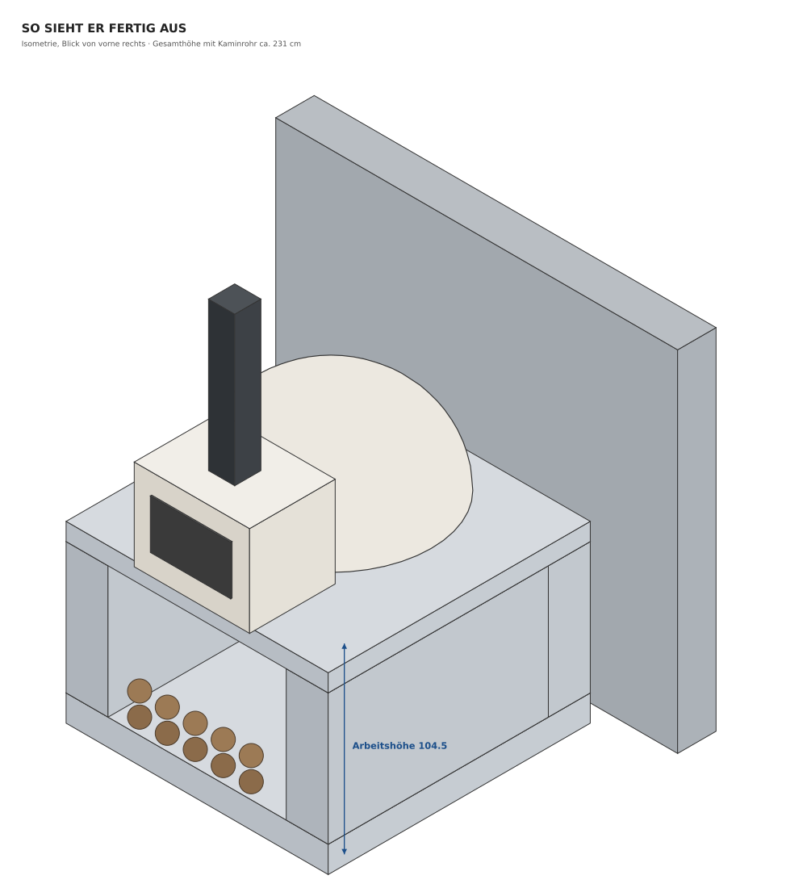

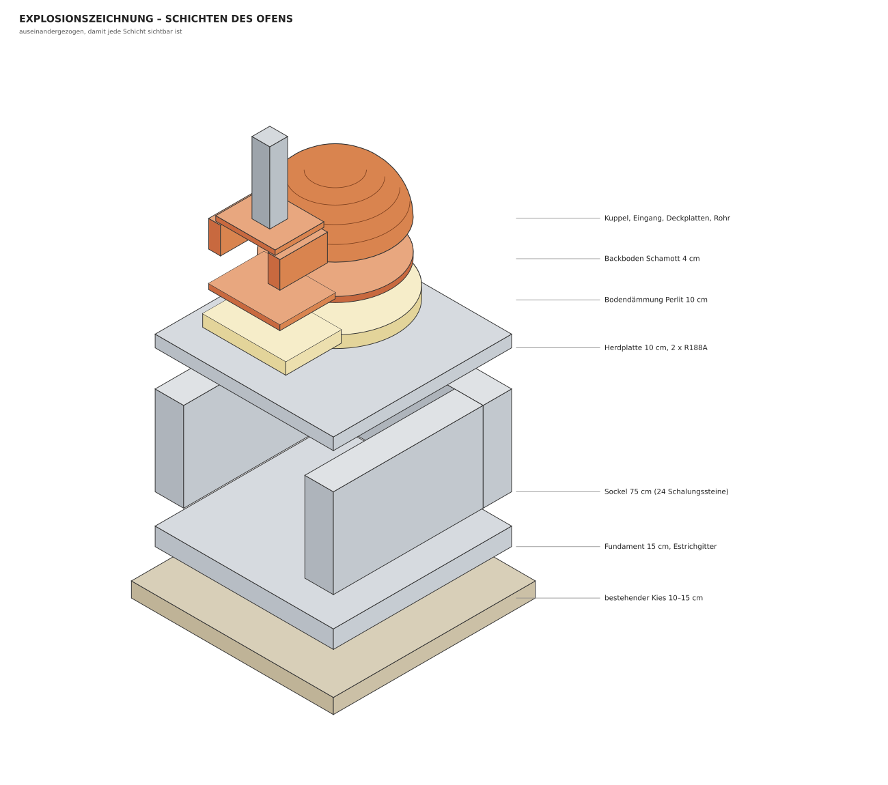

| Schicht | von – bis (Höhe über ±0) | Dicke |
|---|---|---|
| Sand (gewachsen), Vlies als Trennlage | unter −25 | – |
| **Kieskoffer 0/31.5, verdichtet** | −25 bis −10 | 15 |
| Fundament (Beton, Estrichgitter) | −10 bis +5 | 15 |
| Sockel (3 Lagen Schalungssteine) | +5 bis +80 | 75 |
| Herdplatte (Stahlbeton, 2 × R188A) | +80 bis +90 | 10 |
| Bodendämmung Perlit-Zement | +90 bis +100 | 10 |
| Sandbett | +100 bis +100.5 | 0.5 |
| Backboden Schamottplatten | +100.5 bis **+104.5 = Arbeitshöhe** | 4 |
| Kuppel innen | bis +140.5 (Scheitel) | 36 hoch |
| Kuppel aussen (mit Dämmung + Putz) | bis +157.9 | Wand 17.4 |
| Tunnel / Deckplatten | Tür 22.4 hoch, Deckplatten bis +130.9 | – |
| Kaminrohr (euer eigenes) | bis ca. +231 bei 1 m Rohr | 1 m |

**Mittelpunkt der Kuppel (M):** x = 75 (Mitte), y = 73.4 cm von der Sockel-Hinterkante. Den Punkt M braucht ihr bei Bodendämmung, Backboden, Sandform und Kuppel.

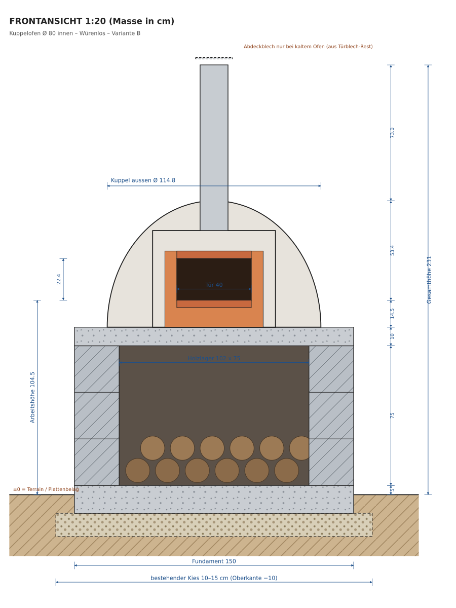

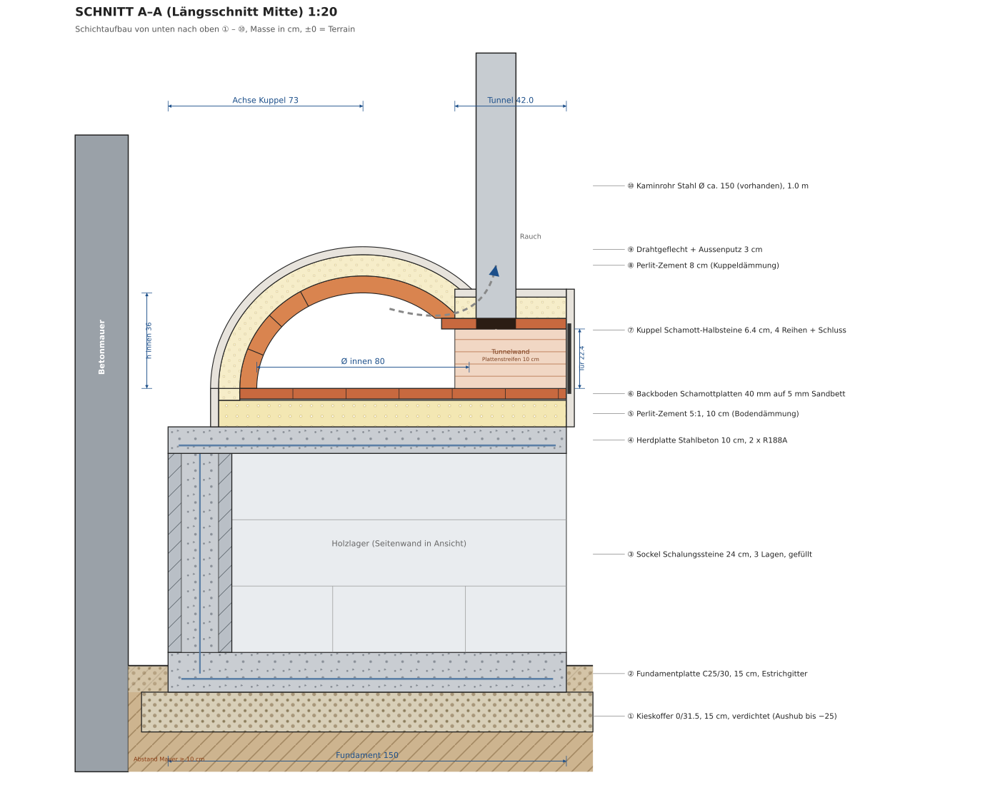

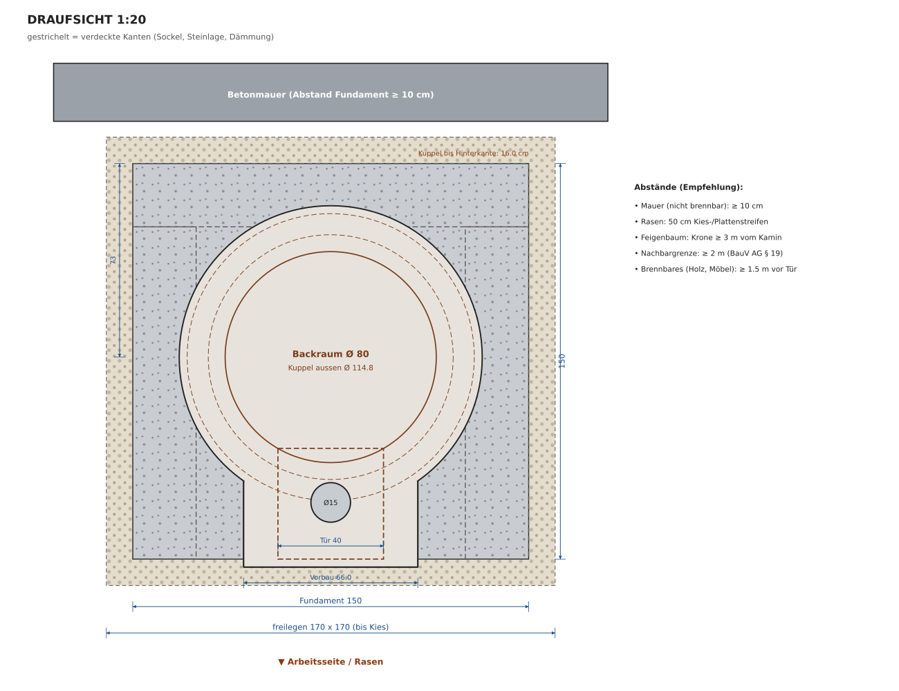

---

## 2. Material: was ihr habt, was noch fehlt

### 2.1 Mengenbilanz

<!--BILANZ-->

### 2.2 Schon gekauft (OBI Volketswil, Fahrten B und C)

<!--GEKAUFT-->

### 2.3 Noch kaufen: eine Fahrt Oftringen → Basel

**Route:** Würenlos → **OBI Oftringen** (42 km) → **OBI Basel Dreispitz** (55 km) → Würenlos (66 km). Ca. 165 km, 2½ h Fahrzeit plus zweimal 30–45 min Einkauf. Ladung ca. 600 kg, also unter den 900 kg pro Fahrt.

**Vorher:** OBI Basel anrufen (**058 329 11 00**) und die **21 Schamottsteine** (Art. 5390067) zurücklegen lassen. Der Bestand schwankt stark: Oftringen ist in 6 Tagen von 25 auf 0 gefallen.

**Reihenfolge:** zuerst Oftringen (schliesst Mo–Do um 19 Uhr), dann Basel (offen bis 20 Uhr). Wer heute noch fährt, startet spätestens um **16:15**.

<!--FAHRT_A-->

**Nur kaufen, wenn ihr es nicht zuhause habt:** Planen (ihr braucht **mindestens 3 Stück 4 × 5 m**: Baugrube, Abdecken, Planenzelt über der Kuppel), Spanngurte, Antirutschmatten, Handschuhe.

**Wenn etwas fehlt:** Schamottsteine in Basel unter 21 → Rest in Volketswil (9) oder Winterthur (3). Stampfer in Oftringen weg → Basel (4 an Lager). Zement → Basel (über 300 an Lager).

### 2.4 Kieswerk Tägerhard

Tägerhard Kies AG, Tägerhardstrasse 151, 5430 Wettingen · **056 426 70 45** · Mo–Fr **07:00–12:00 / 13:00–16:45** · selbst schaufeln, Privatpreis **CHF 60.–/m³**. Bei K1 fragen, ob alle vier Fahrten als ein Bezug abgerechnet werden.

<!--KIES-->

**Laden:** 6 Mörtelkästen (je ca. 80 l) und 10 Eimer (je ca. 15 l) fassen 630 l. Schwere Last nach vorne an die Trennwand, flach, auf die Antirutschmatte, 4 Gurte. Der Bus sieht halb leer aus und ist trotzdem voll.

### 2.5 Von zuhause (oder ausleihen)

| Werkzeug | Werkzeug | Schutz und Betrieb |
|---|---|---|
| 2 Schaufeln, Spaten, Schubkarre, Rechen | Wasserwaage 1 m (besser zusätzlich 2 m) | Staubmaske **mind. FFP2** |
| Rollmeter, **Maurerschnur**, Kreide | Gummihammer, Hammer, Meissel | Schutzbrille, Gehörschutz |
| Handsäge, Akkuschrauber + 3-mm-Bohrer | Winkelschleifer 125 mm | Arbeitshandschuhe |
| Gartenschlauch mit Brause | gerade Latte 2 m (Richtlatte) | Löschdecke, Metall-Ascheeimer mit Deckel |
| Kneifzange, Seitenschneider | Zeitungen, Klebeband, Karton (Keil-Lehren) | alte Decken (Frostschutz nachts) |
| **Kaminrohr** (vorhanden) | | |

---

## 3. Terminplan ab heute (Prognose Open-Meteo vom 19.10.)

| Datum | Wetter (min/max, Regen) | Schritt | Leute | Zeit |
|---|---|---|---|---|
| **Mo 19.10.** | 8/15 °C, trocken | **Einkaufsfahrt Oftringen → Basel** (2.3), wenn ihr heute noch fahren könnt | 1–2 | 4 h |
| **Di 20.10.** | 9/16 °C, trocken | **K1** 07:00 · **S1** Abstecken + Aushub · **S2** Kieskoffer · **S3** Schalung | 2 | 8 h |
| Mi 21.10. | 8/12 °C, **17 mm Regen** | Baugrube unter Plane. Unter Dach: Stützen, OSB, Gitter, Matten und Steckeisen zuschneiden (S3, S6) | 1–2 | 3 h |
| **Do 22.10.** | 5/12 °C, 1 mm | **K2** 07:00 · **S4** Fundament betonieren, **bis 15 Uhr fertig**, dann abdecken (Nacht 3 °C) | 2–3 | 5 h |
| **Fr 23.10.** | 3/13 °C, 2 mm | **K3** 07:00 · **S5** Sockel mauern, bis 15 Uhr, danach Plane + Decke | 2 | 6 h |
| Sa 24.10. | 6/12 °C, 4 mm | **S6 Teil 1:** Herdplattenschalung stellen, unter Plane. Kein Beton | 2 | 5 h |
| So 25.10. | 9/17 °C, **29 mm Regen** | nichts, Planen kontrollieren. **Zeitumstellung:** ab heute um ca. 17:20 dunkel | – | – |
| **Mo 26.10.** | 6/17 °C, 1 mm | **K4** 07:00 · **S6 Teil 2:** Sockel füllen + Herdplatte giessen | **3** | 8 h |
| **Di 27.10.** | 6/16 °C, 1 mm | Herdplatte nass halten · **S7** Bodendämmung | 2 | 3 h |
| **Mi 28.10.** | 6/16 °C, trocken | **S9** Steine schneiden: 35 NF halbieren, Keilsteine Reihe 2–4 | 2 | 6 h |
| **Do 29.10.** | 8/16 °C, 1 mm | **S9** Platten längs, Deckplatten · **S16** Tür · Schablone sägen (S11) | 1–2 | 4 h |
| **Fr 30.10.** | 6/14 °C, trocken | **S8** Backboden (3 Tage nach der Dämmung) · **S11** Sandform | 2 | 5 h |
| **Sa 31.10.** | 5/16 °C, trocken | **S12** Kuppel mit **S10** Tunnelwänden, D1, D2. Start **07:30**, hell bis ca. 17:10 | 2 | 9 h |
| So 1.11.–Mo 2.11. | 3 mm Regen, Nacht **2 °C** | Planenzelt, nicht anfassen. Nachts alte Decken über die Kuppel, Plane darüber | – | – |
| **Di 3.11.** | 4/6 °C, 4 mm | **S13** Sand ausräumen, verfugen, Kaminrohr einmörteln (unter dem Planenzelt) | 2 | 3 h |
| **Do 5.11.** | – | Herdplatten-Stützen entfernen (10 Tage nach dem Giessen) | 1 | 1 h |
| **ab Sa 7.11.** | Regel 3.1 | **S14** Kuppeldämmung 8 cm | 2 | 4 h |
| **ab Sa 14.11.** | Regel 3.1 | **S15** Geflecht + Putz | 2 | 5 h |
| **ab Sa 21.11.** | – | **S17** Trockenbrennen 7 Tage, dann **erste Pizza (frühestens Sa 28.11.)** | 1–2 | 7 × 2–4 h |

**Fahrt A nicht heute?** Dann fahrt ihr am **Di 20.10. um 08:00**. K1 holt ihr am Di um 13:00, graben könnt ihr am Nachmittag. Kieskoffer und Schalung macht ihr am Mi unter der Plane. **Das Fundament bleibt am Do**, und alle anderen Termine bleiben auch.

**Unter der Woche nicht möglich?** Dann bleiben die Reihenfolge und die Wartezeiten aus 3.2 gleich, nur die Daten verschieben sich. Das Kieswerk hat am Samstag zu: die Fahrten K1 bis K4 müssen auf einen Werktag.

### 3.1 Wetterregel für Beton, Mörtel, Perlit und Putz

Am Vorabend in der MeteoSchweiz-App die Prognose für Würenlos prüfen:

1. Die nächsten 3 Nächte alle **≥ 5 °C** → arbeiten.
2. Eine Nacht zwischen **0 und 5 °C** → arbeiten, aber **bis 15 Uhr fertig** sein. Danach abdecken: Latten als Abstand, alte Decken, Plane darüber.
3. Eine Nacht **unter 0 °C** → nicht betonieren, mauern oder putzen. Einen Tag verschieben.
4. **Regen über 2 mm** → nur unter einem Planendach arbeiten, Frisches 24 h abdecken. Rührwerk und Kabel nie im Regen.
5. Ist die **Kuppel am 15.11. noch nicht gemauert**, überwintert ihr den Sockel mit Dämmung unter der Plane und baut die Kuppel im März.
6. Ist die Kuppel gemauert, aber für **Dämmung oder Putz ist es zu kalt**: Kuppel unter dem Planenzelt trocken halten. Die Trocknungsfeuer der Tage 1–3 (bis 200 °C, Kapitel 7) dürft ihr schon machen, sie wärmen und trocknen. Den Rest macht ihr bei über 5 °C, notfalls im Frühling.

### 3.2 Fixe Wartezeiten

| Wartezeit | Dauer |
|---|---|
| Fundament → Sockel mauern | 1 Tag |
| Sockel → Herdplatte giessen | 2 Tage |
| Herdplatte → Bodendämmung | 1 Tag |
| Bodendämmung → Backboden | 3 Tage |
| Kuppel → Sand ausräumen | 3 Tage |
| Herdplatte → Stützen entfernen | 10 Tage |
| Kuppeldämmung → Putz | 7 Tage |
| Putz → Trockenbrennen | 7 Tage |

Verschiebt sich ein Schritt, verschiebt sich alles danach um gleich viel.

---

## 4. Mischungen (Rezepte)

Gemischt wird im **Mörtelkasten** mit dem **Rührwerk**: zuerst Wasser, dann Zement, dann den Zuschlag schaufelweise. Mischt mindestens 3 Minuten, bis alles gleichmässig ist. **1 Eimer** = 20-l-Eimer **bis zur Markierung 14 l** gefüllt (einmal mit Wasser abmessen und innen mit Filzstift markieren).

| Mischung | pro Mischung | Wasser | Ergibt | Wofür |
|---|---|---|---|---|
| **Beton** | ½ Sack Zement (12.5 kg) + **3 Eimer Betonkies** | ca. 5–6 l | ca. 39 l | Fundament **9 ×**, Sockelfüllung + Herdplatte **16 ×** |
| **Mörtelbett** | 1 Schaufel Zement + 4 Schaufeln Sand | nach Gefühl | ca. 10 l | 1. Lage Sockel (2 ×) |
| **Perlit-Zement 5 : 1** | ½ Sack Perlit (50 l) + **10 l Zement** (≈ 13 kg) | ca. 12–15 l | ca. 45 l | Bodendämmung **3 ×**, Kuppeldämmung **5 ×** |
| **Schamottmörtel** | 1 Sack Sakret 5 kg | laut Sack | ca. 3 l | Kuppel, Tunnel, Deckplatten, Rohr (5 Sack) |
| **Putz 1 : 4** | 1 Eimer Zement + 4 Eimer Sand (je halb voll) | nach Gefühl | ca. 30 l | Aussenputz (3 ×) |

**Konsistenzproben:**
- **Beton:** Eine Handvoll zusammendrücken. Er hält als Ball, glänzt feucht, aber es tropft kein Wasser. Zu nass gibt schwachen Beton, also lieber noch eine Schaufel Kies dazu.
- **Perlit-Zement:** erdfeucht und krümelig. Zusammengedrückt hält er knapp. Das Rührwerk nur langsam laufen lassen, sonst zerreibt es das Perlit.
- **Schamottmörtel:** wie dicke Zahnpasta. Er muss an der senkrechten Kelle kleben bleiben.

**Zementbilanz:** Beton 25 Mischungen = 312.5 kg, Perlit 8 Mischungen = 104 kg, Putz ca. 27 kg, Mörtelbett ca. 6 kg → **{{ZEMENT_KG}} kg**. Gekauft werden **{{ZEMENT_KAUF}} Sack = {{ZEMENT_KAUF_KG}} kg**, Reserve ca. {{ZEMENT_RESERVE}} kg.

---

## 5. Bauetappen auf einen Blick

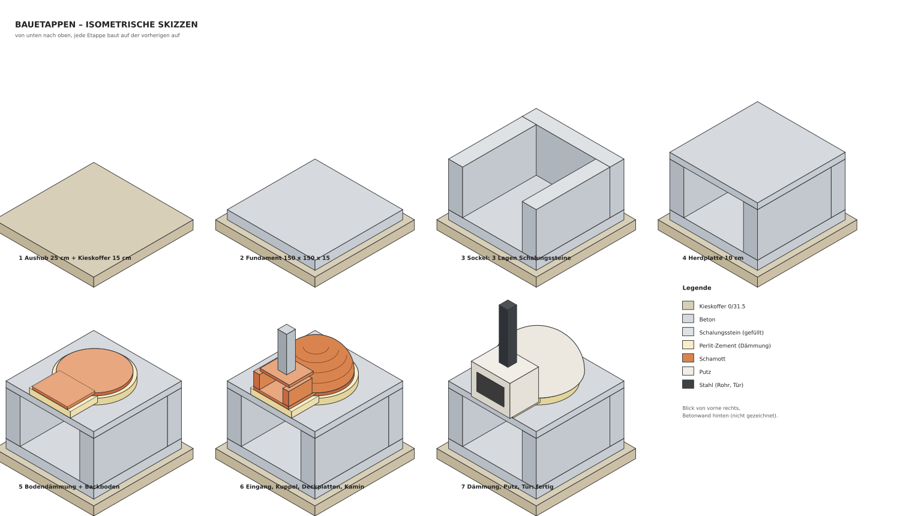

---

## 6. Bauanleitung Schritt für Schritt

Jeder Schritt hat: **Wann · Material · Werkzeug · Ablauf · Kontrolle · Achtung**. Hakt die Kontrollen ab, bevor ihr weitermacht.

### S1 – Abstecken und Aushub (Di 20.10., 3 h, 2 Personen)
**Material:** Schnur, 4 Pflöcke, Kreide, 2 Planen · **Werkzeug:** Rollmeter, Spaten, 2 Schaufeln, Schubkarre, Richtlatte

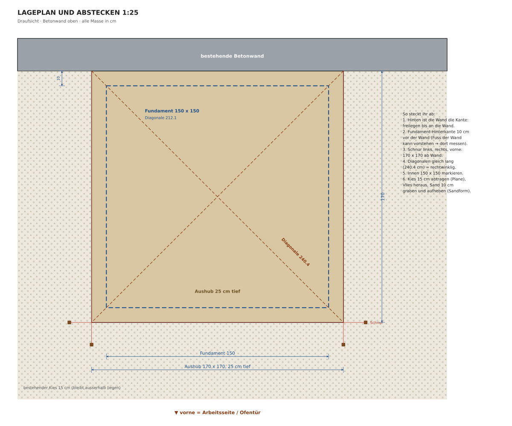

1. **Pflöcke:** Sägt die vier 2-m-Bretter gleich jetzt in je **73.2 + 73.2 + 53.6 cm**. Die 73.2er sind die Stützen für die Herdplatte (S6), die 53.6er eure Pflöcke. Ein Ende spitz sägen.
2. Messt vom **Fuss der Betonwand** 10 cm nach vorne: Das ist die Hinterkante des Fundaments. Steht der Wandfuss vor, messt ab dem vordersten Punkt.
3. Spannt die Schnur links, rechts und vorne. Das Rechteck ist **170 × 170 cm** ab der Wand und steht mittig zur geplanten Ofenachse.
4. **Rechtwinklig prüfen:** Beide Diagonalen messen. Sie müssen gleich lang sein (**240.4 cm**, ±0.5 cm). Sonst die vorderen Pflöcke verschieben.
5. **Kies abtragen:** innerhalb der Schnur die ca. 15 cm Kies abschaufeln, auf **Plane 1**. Damit füllt ihr später den Rand rund ums Fundament auf.
6. **Vlies** herausschneiden und aufheben.
7. **Sand graben:** weitere ca. 10 cm, bis **−25 cm** unter der Kies-Oberkante, auf **Plane 2**. **Diesen Sand braucht ihr für die Sandform** (S11, 0.12 m³). Abdecken, damit er feucht bleibt.
8. Die Sohle eben abziehen. Messt an **5 Stellen** (4 Ecken + Mitte): Richtlatte auf den Kies daneben legen, von ihrer Unterkante nach unten messen. Ziel **25 cm** (±2).
9. Das **Vlies flach auf die Sohle** legen. Es trennt Sand und Kieskoffer.

**Kontrolle:** ☐ Diagonalen gleich ☐ Sohle überall −25 ±2 ☐ Sand für die Sandform aufgehoben und abgedeckt
**Wenn ihr auf Erde stosst:** Kommt schon vor −25 dunkle, weiche Erde (Humus) oder Lehm, grabt ihr bis auf festen Boden weiter. Pro 5 cm tiefer braucht ihr **0.15 m³ mehr Kiesgemisch** (bei K1 gleich mehr laden). Wurzeln entfernen.

### S2 – Kieskoffer einbauen und verdichten (Di 20.10., 2 h)
**Material:** 0.55 m³ Kiesgemisch 0/31.5 (K1), Wasser · **Werkzeug:** **Stampfer**, Schaufel, Rechen, Richtlatte, Wasserwaage, Gartenschlauch

1. Kiesgemisch in **3 Lagen** einbringen, jede ca. 6–7 cm lose (verdichtet je 5 cm).
2. Jede Lage mit dem Rechen eben verteilen, **nässen** (Brause, nicht schwemmen) und mit dem Stampfer **zweimal in Bahnen** überstampfen. Die zweite Bahn versetzt zur ersten.
3. Nach der 3. Lage liegt die Oberkante bei **−10** (±1). Mit der Richtlatte prüfen, hohe Stellen abkratzen, tiefe auffüllen und nachstampfen.
4. **Probe:** Draufstehen und auf dem Absatz drehen. Es bleiben keine Fussabdrücke und keine Kuhle.

**Kontrolle:** ☐ Oberkante −10 ±1 überall ☐ keine Fussabdrücke ☐ Lücke unter der Richtlatte < 1 cm
**Achtung:** Nicht den alten Gartenkies dafür nehmen. Runder Kies rollt unter dem Stampfer weg und wird nie fest.

### S3 – Fundamentschalung und Gitter (Di 20.10. oder Mi 21.10. unter Plane, 3 h)
**Material:** 3 Schalbretter 3 m, Schrauben, 2 Estrichgitter, Bindedraht, 4 Pflöcke · **Werkzeug:** Handsäge, Akkuschrauber, Wasserwaage, Metall-Trennscheibe, Zange

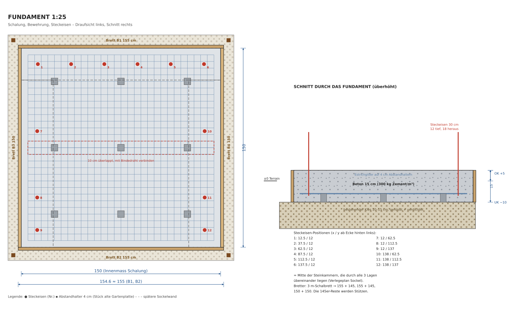

1. **Bretter sägen:**
   - Brett 1 → 155 + 145 cm
   - Brett 2 → 155 + 145 cm
   - Brett 3 → 150 + 150 cm

   Die zwei **145er-Reste** nicht wegwerfen: einer wird die 9. Stütze (S6), der Rest Pflöcke.
2. Die zwei 155er (B1 hinten, B2 vorne) und die zwei 150er (B3, B4 seitlich) **hochkant** auf den Kieskoffer stellen. Die 150er stehen **zwischen** den 155ern. Innenmass **150 × 150 cm**.
3. Ecken mit je 2 Schrauben verbinden. Die Bretter sind 15 cm hoch: Unterkante auf dem Koffer (−10), **Oberkante +5**.
4. **Wasserwaage:** alle vier Bretter waagrecht, auch über Eck. Wo nötig Koffer unten wegkratzen oder unterlegen.
5. **Diagonalen** innen: beide **212.1 cm**.
6. Aussen 4 Pflöcke an die Ecken schlagen. Den **alten Kies** von Plane 1 aussen an die Bretter schaufeln und festtreten. Er stützt die Schalung und füllt den Rand bis ±0.
7. **Innen eine Linie 10 cm unter der Brett-Oberkante** anzeichnen (= 5 cm über dem Koffer). Bis dahin kommt die erste Betonschicht.
8. **Gitter zuschneiden:** beide Estrichgitter auf **140 × 75 cm**, mit 10 cm Überlappung zu **140 × 140** zusammenbinden. Bereitlegen.
9. **Bewehrung für später gleich mitschneiden** (Metallscheibe), aus den zwei R188A-Matten:
   - je **140 × 100 cm** für die Herdplatte. Diese Stücke müssen ganz bleiben.
   - aus den beiden 90-cm-Resten: **12 Stäbe à 30 cm** (kurze Steckeisen) und **12 Stäbe à 80 cm** (lange Steckeisen).

**Kontrolle:** ☐ Innenmass 150 × 150 ☐ Diagonalen 212.1 ☐ Oberkante waagrecht auf +5 ☐ Gitter 140 × 140 bereit ☐ 12 kurze + 12 lange Steckeisen bereit

### S4 – Fundament betonieren (Do 22.10., 4 h, 2–3 Personen)
**Material:** 4½ Sack Zement, 0.38 m³ Betonkies (27 Eimer, K2), Wasser · **Werkzeug:** Rührwerk, 2 Mörtelkästen, Schaufeln, Schubkarre, Richtlatte, Kelle, Rollmeter

1. Koffer kurz nässen (nicht schwemmen).
2. **Erste Schicht:** 3–4 Mischungen Beton (Kapitel 4) bis zur Linie (5 cm dick) verteilen und grob eben ziehen.
3. **Gitter** darauflegen, rundum 5 cm Abstand zur Schalung, leicht eindrücken.
4. **Restliche Mischungen** (total 9) darauf. Person 1 mischt, Person 2 verteilt und stochert mit der Schaufel, bis keine Luft mehr aufsteigt. Nach jeder Mischung aussen an die Schalung klopfen.
5. Mit der **Richtlatte** auf den Brettern hin und her ziehend abziehen. Oberkante = Brett-Oberkante.
6. **Steckeisen setzen** (nach 30–60 Minuten, wenn der Beton etwas angezogen hat): die 12 kurzen Stäbe **senkrecht 12 cm tief** an die Positionen aus der Zeichnung, 18 cm schauen heraus. Gemessen ab der **Ecke hinten links** (x nach rechts, y nach vorne).
7. Oberfläche leicht mit dem Besen aufrauen, damit das Mörtelbett der ersten Steinlage haftet.
8. **Bis 15 Uhr fertig.** Danach Latten auflegen, alte Decken, Plane darüber (Nacht auf Fr 3 °C). Ab Fr 3 Tage lang 2 × täglich nässen, Plane bleibt drauf.

**Kontrolle:** ☐ Oberfläche eben (Richtlatte, Lücke < 5 mm) ☐ 12 Steckeisen senkrecht, an der richtigen Stelle ☐ abgedeckt
**Achtung:** Zement ist ätzend: Handschuhe tragen, Spritzer sofort mit Wasser abwaschen. Kein Wasser nachgiessen, wenn der Beton zäh wird: Kehrt ihn lieber kräftig um.

### S5 – Sockel mauern (Fr 23.10., 5 h)
**Material:** 25 Schalungssteine (24 + 1 zum Halbieren), Mörtelbett 2 Mischungen (Sand aus K3) · **Werkzeug:** Wasserwaage, Gummihammer, Maurerschnur, Kelle, Winkelschleifer mit Diamantscheibe, Hammer + Meissel

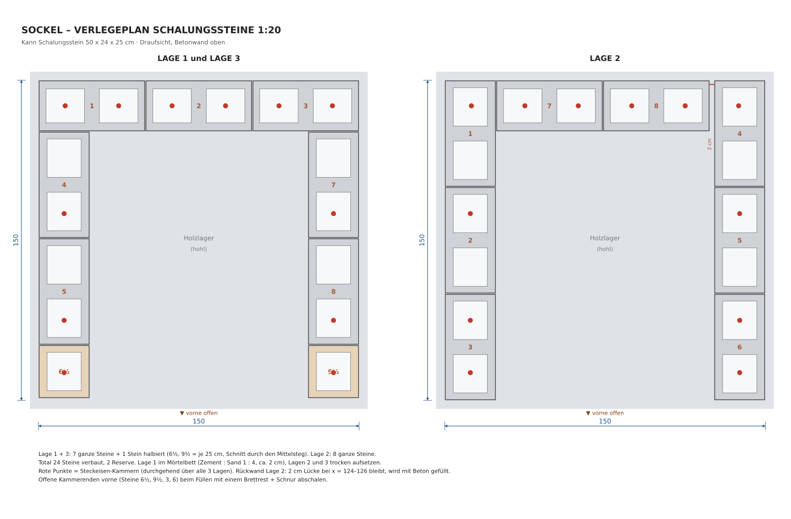

1. **Einen Stein halbieren** (Zeichnung Z13 ③): Aussenwände bei 25 cm durchschneiden, Mittelsteg brechen. Das gibt die Steine **6½** und **9½**.
2. Den **Umriss** der Wand mit Kreide aufs Fundament zeichnen (Aussenkanten = Fundamentkanten).
3. **Lage 1 im Mörtelbett (ca. 2 cm):**
   1. Zuerst die Ecksteine **1** und **3** setzen, dann Stein **2**.
   2. Dann die Seiten **4–5–6½** und **7–8–9½**.
   3. Jeden Stein mit der Wasserwaage in **beide Richtungen** ausrichten und mit dem Gummihammer klopfen.
   4. Die Steckeisen müssen in die Kammern passen. Steht eines im Weg, biegt es leicht zur Kammermitte.
4. Zwischen den Ecksteinen eine **Schnur** auf Steinoberkante spannen. Die Steine dazwischen kommen genau an diese Schnur.
5. **Lage 2 trocken** nach Plan «Lage 2» aufsetzen. Die Seiten laufen jetzt durch. Hinten liegen 2 Steine mit einer 2-cm-Lücke.
6. **Lage 3 trocken** wie Lage 1 aufsetzen.
7. Oberkante kontrollieren: überall **+80** (= 75 cm über dem Fundament). Kleine Unterschiede gleicht die Herdplatte aus.
8. **Kammern vorne abschalen:** die offenen Kammerenden vorne mit einem Brettrest abdecken und mit Bindedraht festbinden.
9. **Bis 15 Uhr fertig**, dann Decke und Plane darüber (Nacht 3 °C, Regen am Wochenende).

**Kontrolle:** ☐ Lage 1 waagrecht ☐ Aussenkanten senkrecht ☐ Diagonalen der Lage 3 gleich ☐ Kammern über den Steckeisen frei
**Achtung:** Schalungssteine wiegen 27 kg. Zu zweit oder aus den Knien heben.

### S6 – Herdplatte: Schalung, Füllen, Giessen (Sa 24.10. + Mo 26.10., 3 Personen am Mo)
**Material:**
- 2 OSB-Platten, 9 Stützen à 73.2 cm, 4 Fundamentbretter wiederverwenden
- 2 R188A à 140 × 100, 12 Stäbe à 80 cm, Bindedraht
- 8 Sack Zement, 0.67 m³ Betonkies (48 Eimer, Rest K2 + K3 + K4)

**Werkzeug:** Säge, Akkuschrauber, Rührwerk, Richtlatte, Wasserwaage

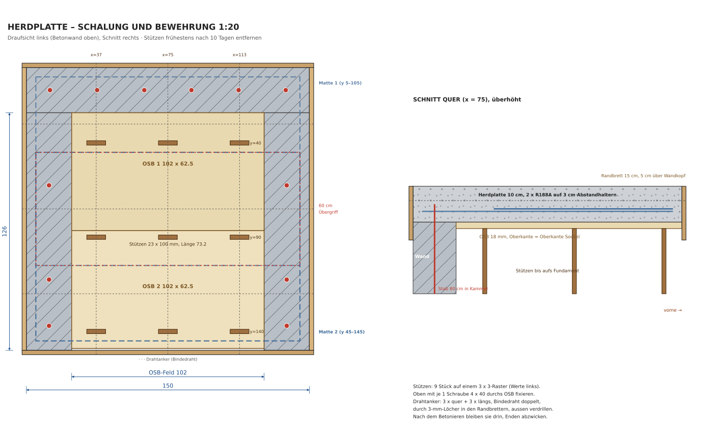

**Teil 1 – Sa 24.10. (unter Plane, kein Beton):**
1. **9. Stütze** aus einem 145er-Rest sägen (73.2 cm).
2. **OSB zusägen:** beide Platten auf **102 cm** Länge (62.5 cm breit lassen). Die zwei Reste (148 × 62.5) aufheben: Daraus werden die Schablone und der Dämmrand.
3. **Stützen stellen:** 9 Stützen nach Raster (x = 37 / 75 / 113, y = 40 / 90 / 140) aufs Fundament. OSB 1 hinten, OSB 2 vorne darauflegen, Nut und Feder zusammen. **Oberkante OSB = Oberkante Sockel** (Latte über die Wände). Zu hoch: Stütze kürzen, zu tief: Holzrest unterlegen. Jede Stütze von oben mit 1 Schraube durchs OSB fixieren.
4. **Randbretter:** die 4 Fundamentbretter als Rahmen um den Sockel. Sie stehen 5 cm am Wandkopf herunter und 10 cm über die Sockeloberkante (Oberkante = +90). Vorne liegt das Brett auf der OSB-Kante, 3 Schrauben.
5. **Drahtanker:** in jedes Brett 3 Löcher (3 mm) auf 6 cm unter der Oberkante. Bindedraht doppelt quer und längs durchziehen, aussen verdrillen, bis die Bretter satt anliegen.
6. **Lange Steckeisen:** die 12 Stäbe à 80 cm von oben in die Kammern mit den kurzen Steckeisen stecken, bis aufs Fundament.
7. Innen an den Randbrettern eine **Linie 3 cm über dem OSB** anzeichnen. Alles mit Plane abdecken.

**Teil 2 – Mo 26.10.:**
1. **Kammern füllen** (ca. 10 Mischungen): lagenweise, zuerst bis zur Hälfte von Lage 1, dann bis Lage 2, dann bis zuoberst. Jede Lage mit einer Latte stochern.
2. **Erste Plattenschicht:** Beton 3 cm hoch aufs OSB bis zur Linie verteilen.
3. **Matten einlegen:** **Matte 1** hinten (y 5–105), **Matte 2** vorne (y 45–145), **60 cm Übergriff**, an 6 Stellen zusammenbinden.
4. **Rest giessen** (total ca. 6 Mischungen für die Platte), verteilen, stochern, auf **+90** (Brettoberkante) abziehen. Mit der Kelle glätten.
5. Nach 3 h abdecken. **5 Tage nass halten.**

**Kontrolle:** ☐ OSB bündig mit Sockel ☐ Stützen senkrecht und verschraubt ☐ Drahtanker gespannt ☐ Matten im Beton, nicht auf dem OSB ☐ Oberfläche waagrecht
**Achtung:** Unter die Herdplatte nur kriechen, wenn es nötig ist. Die **Stützen bleiben 10 Tage** (bis Do 5.11.). Danach Stützen und OSB vorne herausziehen und die Drahtenden aussen abzwicken.

### S7 – Bodendämmung Perlit-Zement (Di 27.10., 3 h)
**Material:** 1½ Sack Perlit, ca. 39 kg Zement, 16 OSB-Streifen 10 × 15.6 cm (aus OSB-Rest), Klebeband, Nagel + Schnur · **Werkzeug:** Rührwerk (langsam), Kelle, Latte

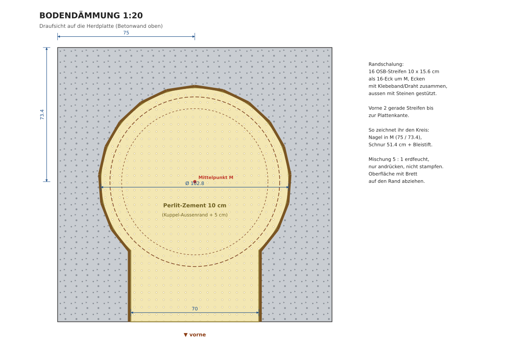

1. **Punkt M** auf der Herdplatte anzeichnen: x = 75 (Mitte), y = 73.4 cm ab Hinterkante.
2. Mit Nagel in M + Schnur **51.4 cm** einen Kreis zeichnen. Vorne gehen zwei gerade Linien 70 cm breit bis zur Kante.
3. **16 OSB-Streifen** (10 cm hoch) als 16-Eck auf die Linie stellen, Ecken mit Klebeband verbinden, aussen mit Steinen stützen. Vorne 2 gerade Streifen.
4. **3 Mischungen Perlit-Zement** (je ½ Sack Perlit + 10 l Zement), erdfeucht einfüllen.
5. **Nur andrücken, nicht stampfen.** Mit einer Latte auf 10 cm (Oberkante der Streifen) abziehen.
6. 3 Tage abdecken, nicht betreten.

**Kontrolle:** ☐ Höhe überall 10 cm ☐ Kreis Ø 102.8 mittig auf M

### S8 – Backboden verlegen und zuschneiden (Fr 30.10., 3 h)
**Material:** 11 Schamottplatten, ca. 5 l trockener Sand · **Werkzeug:** Winkelschleifer + Diamantscheibe, Schnur + Nagel, Gummihammer, Wasserwaage, Schwamm

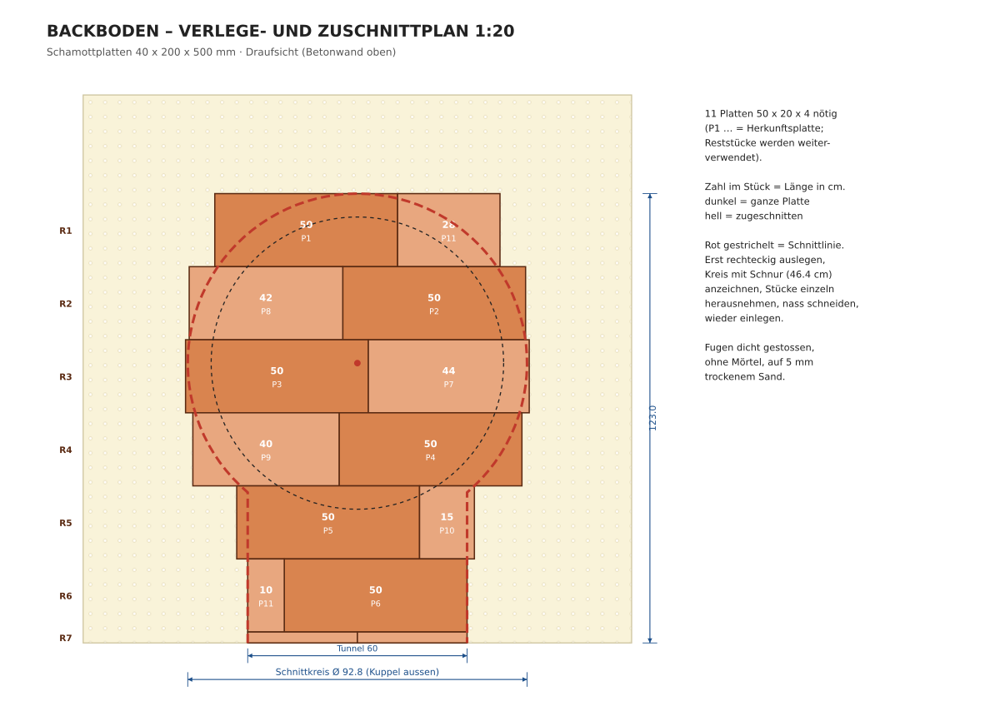

<!--BACKBODEN-->

1. Die OSB-Streifen der Dämmung entfernen. **M** neu auf die Dämmung übertragen (Rollmeter ab Hinterkante und Mitte).
2. **5 mm trockenen Sand** über die Fläche verteilen und mit einer Latte glatt abziehen.
3. Die Platten nach Plan auslegen: **Reihe R1 hinten** bis **R7 vorne**. Die ganzen Platten zuerst, Fugen dicht stossen.
4. Mit **Nagel in M + Schnur 46.4 cm** den Schnittkreis auf die Platten zeichnen. Vorne zwei gerade Linien, 60 cm breit (Tunnel).
5. Die Stücke einzeln herausnehmen, **nass** schneiden (Schwamm, Wasser), wieder einlegen.
6. Jede Platte mit dem Gummihammer festklopfen. **Kanten dürfen nicht vorstehen** (Pizzaschieber!). Prüft das mit der Wasserwaage.

**Kontrolle:** ☐ kein Plattenrand steht vor ☐ Schnittkreis Ø 92.8 um M ☐ Fugen < 2 mm
**Achtung:** Ohne Mörtel verlegen! Die Platten müssen sich bei Hitze ausdehnen können.

### S9 – Steine schneiden (Mi 28.10. + Do 29.10., ca. 9 h)
**Material:** 35 Schamottsteine NF, 7 Schamottplatten (5 für Streifen, 2 Deckplatten), Karton · **Werkzeug:** Winkelschleifer + Diamantscheibe, Bleistift, Brett als Lineal, Gummihammer · **Schutz:** FFP2/FFP3, Brille, Gehörschutz, Handschuhe

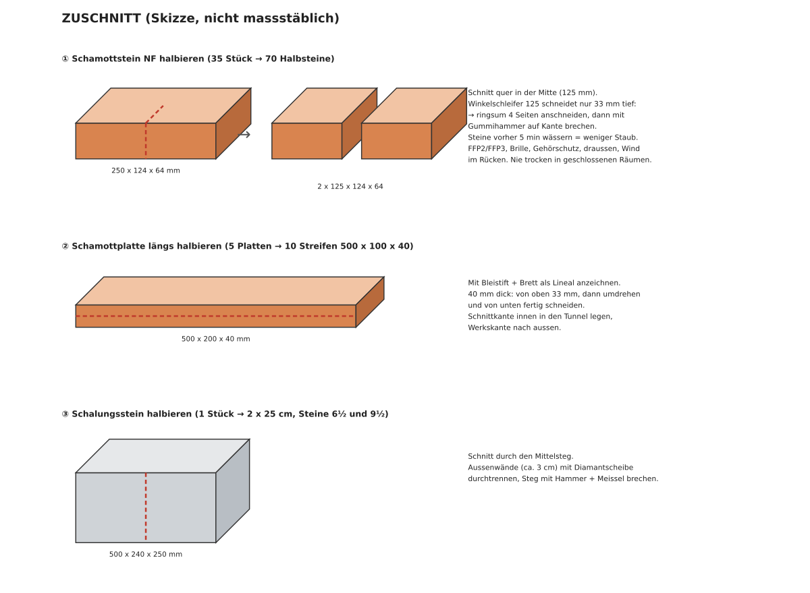

1. **Draussen** arbeiten, mit dem Wind im Rücken. Steine 5 min wässern: Das gibt weniger Staub.
2. **35 NF halbieren** → 70 Halbsteine (Z13 ①).
3. **Keil-Lehren aus Karton** schneiden, je eine pro Reihe (Masse unten). Unten 12.5 breit, oben schmaler, 12.4 hoch.
4. **Keilsteine schneiden** (Z13 ④): Lehre auf die Fläche 125 × 124 legen, beide Seiten anzeichnen, schneiden. Reihe 1 braucht keinen Zuschnitt.

| Reihe | Halbsteine | Breite oben (innen) | je Seite weg |
|---|---|---|---|
<!--KEILE-->

5. **Schluss:** 4 Viertelkreise mit r ≈ 9 cm aus 4 Halbsteinen (Z13 ⑤). Erst am Kuppeltag genau anpassen.
6. **5 Platten längs halbieren** → 10 Streifen 50 × 10 × 4 (Z13 ②).
7. **2 Deckplatten:** in je eine Längskante einen **Halbkreis r = 7.75 cm** schneiden (Z14). Vorher euer Kaminrohr aussen messen: Radius = (Rohr-Ø + 5 mm) / 2. Bei Ø 15 cm sind das 7.75 cm.
8. Alles nach Reihen stapeln und beschriften (Kreide). Die **10 übrigen Halbsteine** sind Reserve für Bruch und Zuschnitt.

**Achtung:** **Nie trocken in Garage oder Keller schneiden.** Quarzstaub ist krebserregend.

### S10 – Tunnelwände (Sa 31.10., nach Kuppel-Reihe 1, 1½ h)
**Material:** 10 Plattenstreifen, Schamottmörtel · **Werkzeug:** Kelle, Fugenkelle, Wasserwaage, Winkelschleifer

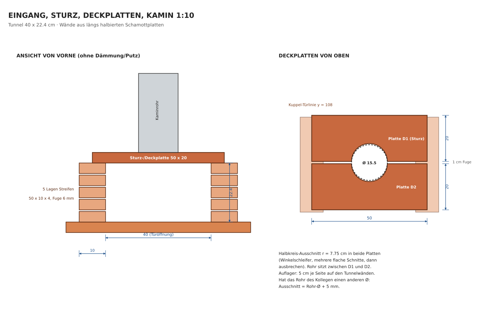

1. Die Tunnelwände stehen **links und rechts der Türöffnung**, Innenabstand **40 cm**, je 10 cm dick, von den Kuppelsteinen 15 und 16 bis zur Vorderkante.
2. Streifen **flach** verlegen, 5 Lagen mit 6-mm-Schamottmörtelfugen → Höhe **22.4 cm**.
3. Das **hintere Ende** jedes Streifens schräg anpassen, bis es satt an den Steinen 15 und 16 der Reihe 1 anliegt (deshalb erst nach Reihe 1 bauen). Spalten mit Mörtel und Schamottstücken füllen.
4. Jede Lage waagrecht und die Wand senkrecht prüfen.

### S11 – Sandform (Fr 30.10., 2 h)
**Material:** ca. 0.12 m³ Sand aus dem Aushub (feucht), Zeitungen, 1 Rundholz/Rohr ca. 60 cm, OSB-Rest · **Werkzeug:** Stichsäge oder Handsäge, Akkuschrauber, Kelle

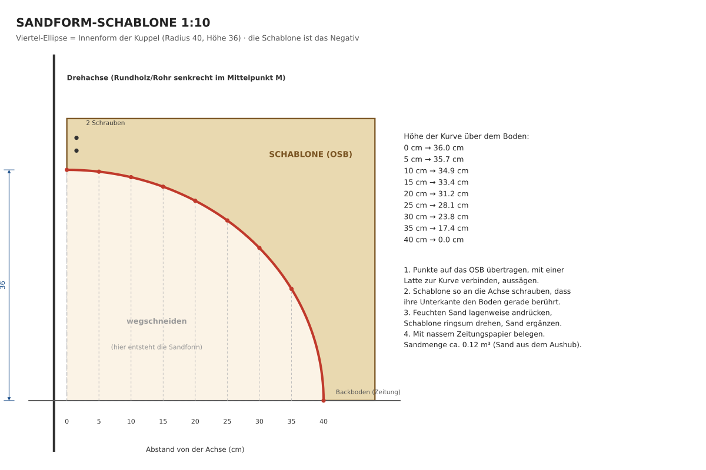

1. **Schablone** aus dem OSB-Rest sägen: Punkte aus der Tabelle übertragen, mit einer biegsamen Latte verbinden, aussägen. Die Schablone ist das **Negativ**: Ihr braucht das Stück **ausserhalb** der Kurve.
2. **Zeitungspapier** auf den Backboden legen: Es schützt die Platten vor dem Sand.
3. Ein **Rundholz senkrecht in M** stellen und unten mit etwas Sand fixieren.
4. Feuchten Sand in Lagen aufschütten und **festdrücken**. Die Schablone ans Rundholz schrauben und **ringsum drehen**. Wo Sand fehlt, nachfüllen, bis die Form glatt ist.
5. Das Rundholz herausziehen, das Loch mit Sand schliessen. Die Form mit **nassem Zeitungspapier** belegen: Der Mörtel klebt nicht am Sand, und später brennt das Papier weg.
6. Über Nacht mit Plane abdecken, damit der Sand feucht bleibt.

**Kontrolle:** ☐ Höhe in der Mitte 36 cm ☐ Ränder treffen den Boden bei r = 40 cm

### S12 – Kuppel mauern (Sa 31.10., 8–9 h)
**Material:** 60 Halbsteine (sortiert nach Reihen) + Reserve, 10 Plattenstreifen, Deckplatten D1 + D2, 5 Sack Schamottmörtel · **Werkzeug:** Kelle, Fugenkelle, Gummihammer, Winkelschleifer, Kübel Wasser, Schwamm

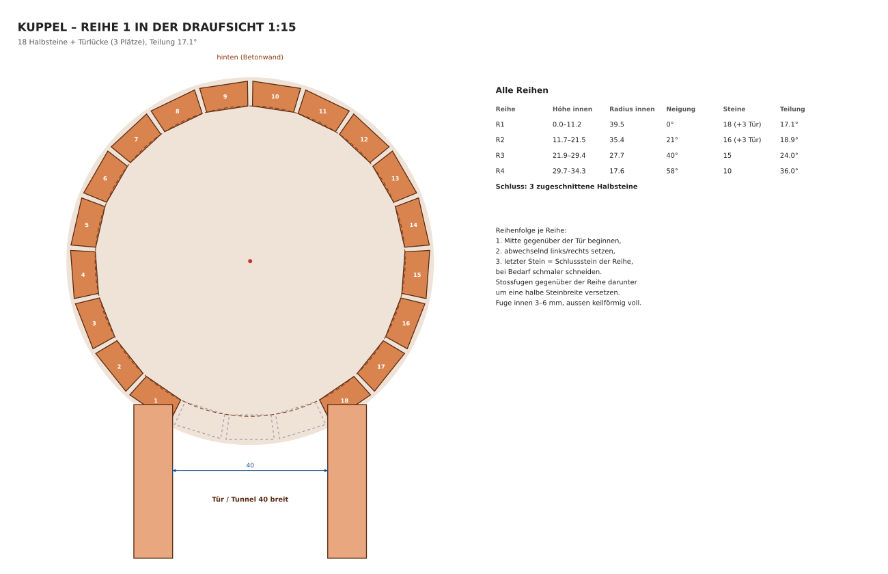

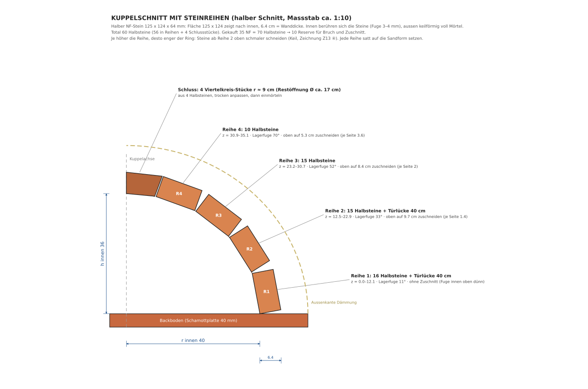

<!--REIHEN-->

1. Halbsteine **10 min wässern**: Trockene Steine saugen dem Mörtel das Wasser weg.
2. Mit Schnur um M den Kreis **r = 40** (Innenkante) und **r = 46.4** (Aussenkante) auf den Backboden zeichnen.
3. **Reihe 1 (16 Steine, ohne Zuschnitt):** Die Fläche 125 × 124 zeigt nach innen, 6.4 cm sind die Wanddicke. Steine 1 und 2 hinten gegenüber der Tür, dann abwechselnd links und rechts nach vorne (Z16). Die Steine 15 und 16 stehen mit ihrer Innenecke bei der Türöffnung (40 cm).
4. **Tunnelwände** hochziehen (S10).
5. **Reihe 2 (15 Keilsteine):** Stossfugen **halb versetzt** zu Reihe 1. Die Steine liegen satt auf der Sandform, die Neigung ergibt sich von selbst. Neben der Tür enden sie an den Tunnelwänden, ihre Oberkante liegt auf Türhöhe (ca. 22.4).
6. **Sturz D1** im Mörtelbett auf die Tunnelwände legen. **Hinterkante bei y = 103** (5 cm hinter der Türlinie), Halbkreis-Kerbe nach vorne. Hinten liegt D1 auf den Steinen von Reihe 2 neben der Tür auf.
7. **Reihe 3 (15 Keilsteine):** Die Steine direkt über der Tür liegen auf D1. Kürzt sie an der Unterkante um ca. 3 cm, damit sie oben mit der Reihe bündig sind (Z13 ⑥).
8. **Reihe 4 (10 Keilsteine).**
9. **Schluss:** Die Restöffnung (Ø ca. 17 cm) mit den **4 Viertelkreisen** schliessen. Vorher trocken einlegen und anpassen.
10. Aussen alle Fugen voll Mörtel, Oberfläche mit nassem Schwamm verreiben.
11. **Platte D2** mit Mörtel auf die Tunnelwände, 1 cm Fuge zu D1, Kerbe nach hinten. Das Rohrloch liegt zwischen D1 und D2.
12. **Planenzelt** darüber, mit Latten, damit die Plane die Kuppel nicht berührt. 3 Tage nicht anfassen. Nachts unter 5 °C eine alte Decke unter die Plane.

**Kontrolle:**
- ☐ Jede Reihe ringsum gleich hoch
- ☐ Fugen innen 3–4 mm
- ☐ Tür 40 × 22.4
- ☐ Kein Stein wackelt

**Achtung:**
- **Mörtel immer nur für 20–30 min** anmachen. Angezogenen Mörtel nicht mit Wasser «aufwecken».
- Pause: Kuppel mit nassem Tuch abdecken.

### S13 – Sand ausräumen, verfugen, Kaminrohr (Di 3.11., 3 h)
1. Den Sand **durch die Tür** mit der Hand und einer kleinen Schaufel herauskratzen. Das Zeitungspapier bleibt, es verbrennt beim ersten Feuer.
2. Innen alle Fugen kontrollieren. Löcher > 5 mm mit Schamottmörtel nachfugen.
3. **Kaminrohr** senkrecht in das Loch zwischen D1 und D2 stellen und mit Schamottmörtel einbetten. Mit 3 Drähten zu Pflöcken 3 Tage abspannen, damit es senkrecht bleibt.

### S14 – Kuppeldämmung (ab Sa 7.11., 4 h)
**Material:** 2½ Sack Perlit, ca. 65 kg Zement, 15 Bindedraht-Haken à 15 cm · **Werkzeug:** Rührwerk langsam, Kelle, Hände (Handschuhe)

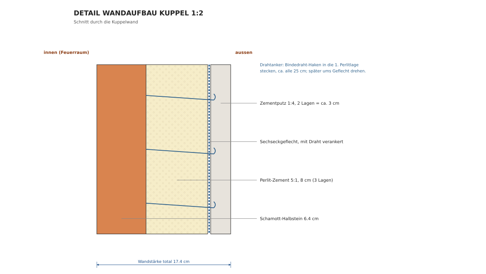

1. Kuppel aussen leicht nässen.
2. **5 Mischungen** Perlit-Zement. In **3 Lagen à ca. 2.7 cm** von unten nach oben andrücken, total **8 cm**.
3. Am **Kuppelfuss** bis auf die Herdplatte hinunter dämmen (dort, wo Bodendämmung und Backboden aufhören). **Tunnel** oben und seitlich mitdämmen.
4. In die erste Lage **Drahthaken** stecken, ca. alle 25 cm, Haken nach aussen. Daran kommt später das Geflecht.
5. Mindestens **7 Tage** unter dem Planenzelt trocknen (Luftspalt!).

### S15 – Geflecht und Putz (ab Sa 14.11., 4 h)
**Material:** Sechseckgeflecht, Bindedraht, Putz 1 : 4 (3 Mischungen, ca. 27 kg Zement + 0.1 m³ Sand)

1. **Geflecht** in Bahnen über die Kuppel legen, 5 cm überlappen und an den Drahthaken festdrehen.
2. **1. Putzlage** 1.5 cm aufwerfen und andrücken, rau lassen. Am nächsten Tag die **2. Lage** 1.5 cm glatt reiben.
3. 3 Tage feucht halten. Regel 3.1 gilt: keine Nacht unter 0 °C.

### S16 – Tür (2 h, jederzeit)
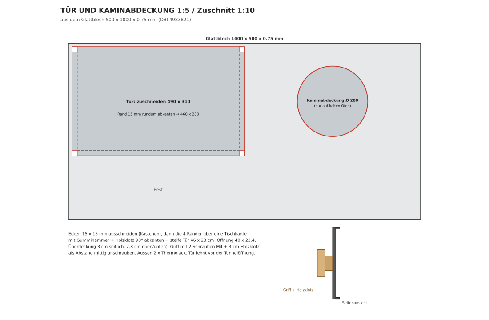

1. Aus dem Glattblech **490 × 310 mm** zuschneiden (Metall-Trennscheibe) und die Ecken 15 × 15 mm ausschneiden.
2. Die Ränder über eine Tischkante **90° abkanten** → 460 × 280 mm.
3. Griff mit **Holzklotz** als Abstand mittig anschrauben (M4 oder Blechschrauben).
4. 2 × Thermolack aussen.
5. Aus dem Rest die **Kaminabdeckung Ø 20 cm** schneiden. Sie kommt **nur auf den kalten Ofen** (Regen).

---

## 7. Trockenbrennen und erstes Feuer (S17)

Frühestens **7 Tage nach dem Putz**. Ziel: Das Restwasser langsam austreiben, sonst reisst die Kuppel.

| Tag | Holz | Ofen innen ca. | Dauer |
|---|---|---|---|
| 1 | Papier + 1–2 kg Kleinholz | 100 °C | 2 h |
| 2 | 2–3 kg | 150 °C | 3 h |
| 3 | 3–4 kg | 200 °C | 3 h |
| 4 | 4–5 kg | 250 °C | 3–4 h |
| 5 | 5–6 kg | 300 °C | 3–4 h |
| 6 | 6–8 kg | 350–400 °C | 4 h |
| 7 | volles Feuer | 450–500 °C | bis die Kuppel innen **weiss** ist → erste Pizza |

- Haarrisse im Putz sind normal. Risse > 2 mm in der Kuppel nach Tag 7 mit Schamottmörtel schliessen.
- Feuer seitlich hinten anlegen, Pizza vorne-mitte backen. Die Tür steht während dem Backen offen.

---

## 8. Sicherheit und Recht

**Beim Bauen:**
- Handschuhe bei Zement und Perlit.
- Staubmaske FFP2/FFP3 beim Schneiden und Perlit-Mischen.
- Brille und Gehörschutz beim Winkelschleifer.
- Schwere Steine zu zweit heben.
- Kabel und Rührwerk nicht im Regen benutzen.
- Baugrube und Pflöcke markieren (Stolpergefahr), nachts abdecken.

**Abstände:**

| Zu | Abstand |
|---|---|
| Nachbargrenze | **≥ 2 m** (BauV AG § 19). Weniger nur mit schriftlicher Zustimmung |
| Feigenbaum (Krone) | ≥ 3 m von der Kaminmündung |
| Brennbares vor der Tür | ≥ 1.5 m |

**Bewilligung:** Gartencheminées in der Bauzone sind bewilligungsfrei (BauV AG § 49 Abs. 2 lit. c), wenn die Abstände eingehalten sind. Eine Meldung per E-Mail an die Bauverwaltung Würenlos (bauverwaltung@wuerenlos.ch) dient der Dokumentation.

**Betrieb:**
- Nur trockenes, unbehandeltes Holz verbrennen.
- Löschdecke und Gartenschlauch liegen bereit.
- Asche 24 h im Metalleimer mit Deckel auskühlen lassen.
- Feuer nie unbeaufsichtigt lassen.
- Bei Feuerverbot nicht feuern.

---

## 9. Kosten

<!--KOSTEN-->

Nicht eingerechnet: Diesel (ca. CHF 35 für die Fahrt nach Basel und das Kieswerk), Werkzeug von zuhause, Brennholz. Preise inkl. MWST, Stand 13.10., heute stichprobenweise bestätigt.

---

## Anhang: Zeichnungsverzeichnis

| Nr. | Zeichnung | Massstab | Schritt |
|---|---|---|---|
| Z1 | Fertiger Ofen (Isometrie) | – | Übersicht |
| Z2 | Explosionszeichnung | – | Übersicht |
| Z3 | Frontansicht | 1:20 | Übersicht |
| Z4 | Längsschnitt A–A | 1:20 | Übersicht |
| Z5 | Draufsicht | 1:20 | Übersicht |
| Z6 | Bauetappen (7 Skizzen) | – | Übersicht |
| Z7 | Lageplan und Aushub | 1:25 | S1 |
| Z8 | Fundament: Kieskoffer, Schalung, Gitter, Steckeisen | 1:25 | S2, S3, S4 |
| Z9 | Sockel: Verlegeplan | 1:20 | S5 |
| Z10 | Herdplatte: Schalung und Bewehrung | 1:20 | S6 |
| Z11 | Bodendämmung | 1:20 | S7 |
| Z12 | Backboden: Verlege- und Zuschnittplan | 1:20 | S8 |
| Z13 | Zuschnitt der Steine, Keilsteine, Schluss | Skizze | S5, S9, S12 |
| Z14 | Eingang, Sturz, Deckplatten, Kamin | 1:10 | S10, S12, S13 |
| Z15 | Sandform-Schablone | 1:10 | S11 |
| Z16 | Kuppel Reihe 1 + Reihentabelle | 1:15 | S12 |
| Z17 | Kuppelschnitt mit Steinreihen | ca. 1:10 | S12 |
| Z18 | Detail Wandaufbau | 1:2 | S14, S15 |
| Z19 | Tür und Kaminabdeckung | 1:5 / 1:10 | S16 |

Alle Zeichnungen und Mengen werden mit den Skripten im Repo aus den Berechnungen erzeugt (`berechnung/`, `zeichnungen/`). Ändert sich ein Mass, rechnet ihr neu, statt von Hand zu korrigieren.
